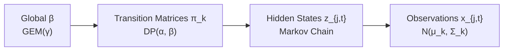

# Chapter 6: HDP-Hidden Markov Model — Temporal Dynamics of Player Form

## 6.1 Introduction

The HDP-GMM presented in Chapter 5 clusters player performances into latent form profiles but treats each gameweek observation as independent, conditional on its cluster assignment. This **iid assumption** is unrealistic for FPL: a player's form is **persistent**. A player who performs at an "Elite" level in gameweek $t$ is more likely to remain at that level in gameweek $t+1$ than to abruptly drop to "Cold." This temporal structure — the autocorrelation of form over time — is not captured by the HDP-GMM.

The **HDP-Hidden Markov Model (HDP-HMM)** addresses this by adding a Markov chain layer on top of the HDP clusters. Each player's form state evolves according to a Markov chain with a transition matrix that governs the probability of moving from one state to another. The HDP prior ensures that transition matrices and emission parameters are shared across players, enabling the model to learn common form dynamics while retaining player-specific variation.

This chapter provides a comprehensive mathematical treatment of the HDP-HMM, including its generative process, the Forward-Filtering Backward-Sampling (FFBS) algorithm for state trajectory inference, action-conditioned transition dynamics, mean-field coupling for population-level form trends, and the NumPyro model specification.

## 6.2 The HDP-HMM Generative Process

### 6.2.1 Extending the HDP-GMM with a Markov Layer

The HDP-HMM retains the global measure $\boldsymbol{\beta}$, the NIW emission parameters $(\mu_k, \Sigma_k)$, and the player-level mixture weights $\boldsymbol{\pi}_j$ from the HDP-GMM developed in Chapter 5. It adds the following new components:

**Transition matrices (new):** For each source state $k = 1, 2, \ldots$, a transition distribution is drawn from a Dirichlet Process with concentration $\alpha$ and base measure $\boldsymbol{\beta}$:

$$\boldsymbol{\pi}_k \sim \text{DP}(\alpha, \boldsymbol{\beta}),$$

so that $\boldsymbol{\pi}_k = (\pi_{k,1}, \pi_{k,2}, \ldots)$ with $\boldsymbol{\pi}_k \mid \boldsymbol{\beta}, \alpha \sim \text{Dir}(\alpha \beta_1, \alpha \beta_2, \ldots)$.

**State evolution (new, per player):** For each player $j = 1, \ldots, J$ and gameweek $t = 1, \ldots, T_j$, the hidden state now follows a Markov chain:

$$\begin{aligned}
z_{j,1} &\sim \boldsymbol{\beta}, \\
z_{j,t} \mid z_{j,t-1} = k &\sim \text{Categorical}(\boldsymbol{\pi}_k), \quad t = 2, \ldots, T_j.
\end{aligned}$$

**Emissions (retained from Chapter 5):** Conditional on the hidden state, observations are emitted from the Gaussian-Wishart base measure:

$$x_{j,t} \mid z_{j,t} = k, \mu_k, \Sigma_k \sim \mathcal{N}(\mu_k, \Sigma_k),$$

where $(\mu_k, \Sigma_k) \sim \text{NIW}(m_0, \kappa_0, \Psi_0, \nu_0)$ as specified in Chapter 5, Section 5.3.2.

The key distinction from the iid HDP-GMM of Chapter 5 is that the probability of occupying state $k$ at gameweek $t$ now depends on the state occupied at gameweek $t-1$ through the transition matrix $\boldsymbol{\pi}_{z_{j,t-1}}$, rather than being drawn independently from the player-specific mixture weights $\boldsymbol{\pi}_j$.

### 6.2.2 Graphical Model

The graphical structure of the HDP-HMM is shown in Figure 6.1. The dependency chain is:



**Figure 6.1:** HDP-HMM graphical model. Global parameters $(\boldsymbol{\beta}, \{\mu_k, \Sigma_k\})$ are drawn once and shared across all players. Transition matrices $\{\boldsymbol{\pi}_k\}$ are drawn once and shared. For each player $j$, a state sequence $z_{j,1:T_j}$ is generated by the Markov chain, and observations $x_{j,t}$ are emitted from the corresponding Gaussian.

### 6.2.3 Interpretation for FPL

The transition matrix $\boldsymbol{\pi}_k$ encodes the **form dynamics** of state $k$:

- $\pi_{k,k}$: the probability of remaining in state $k$ (form persistence).
- $\pi_{k, \ell}$ for $\ell \neq k$: the probability of transitioning from state $k$ to state $\ell$.

For example, if state 1 is "Elite Form" and state 3 is "Cold Form," then:

- $\pi_{1,1} \approx 0.80$: Elite players tend to stay elite (form persistence).
- $\pi_{1,2} \approx 0.15$: Occasionally drop to "Good Form."
- $\pi_{1,3} \approx 0.05$: Rarely drop directly to "Cold Form."

This is a more realistic model than the iid HDP-GMM, which would assign the same probability to any state at any time, regardless of history.

## 6.3 Posterior Inference: Forward-Filtering Backward-Sampling

### 6.3.1 The Challenge

Posterior inference for the HDP-HMM requires sampling the state sequence $\mathbf{z}_{j,1:T_j}$ for each player, conditional on the observations $\mathbf{x}_{j,1:T_j}$ and the model parameters $(\{\mu_k, \Sigma_k\}, \{\boldsymbol{\pi}_k\}, \boldsymbol{\beta})$. The Markov dependency means that each $z_{j,t}$ cannot be sampled independently (as in the HDP-GMM). Instead, the entire trajectory must be sampled jointly.

### 6.3.2 Forward Filtering

The forward algorithm computes the **filtered state probabilities**:

$$\alpha_t(k) = P(z_t = k \mid x_{1:t}), \quad k = 1, \ldots, K.$$

This is computed recursively:

**Initialisation** ($t = 1$):

$$\alpha_1(k) \propto \beta_k \cdot \mathcal{N}(x_1 \mid \mu_k, \Sigma_k).$$

**Recursion** ($t = 2, \ldots, T$):

$$\alpha_t(\ell) \propto \left( \sum_{k=1}^K \alpha_{t-1}(k) \cdot \pi_{k,\ell} \right) \cdot \mathcal{N}(x_t \mid \mu_\ell, \Sigma_\ell).$$

The normalising constant at each step is:

$$c_t = \sum_{\ell=1}^K \sum_{k=1}^K \alpha_{t-1}(k) \cdot \pi_{k,\ell} \cdot \mathcal{N}(x_t \mid \mu_\ell, \Sigma_\ell).$$

The log-likelihood of the observations is:

$$\log P(x_{1:T}) = \sum_{t=1}^T \log c_t.$$

### 6.3.3 Backward Sampling

After computing the filtered probabilities, the state trajectory is sampled backwards:

**Sample the final state:**

$$z_T \sim \text{Categorical}(\alpha_T).$$

**Sample backwards** ($t = T-1, \ldots, 1$):

$$P(z_t = k \mid z_{t+1} = \ell, x_{1:t}) \propto \alpha_t(k) \cdot \pi_{k,\ell}.$$

Thus:

$$z_t \sim \text{Categorical}\left( \frac{\alpha_t(k) \cdot \pi_{k, z_{t+1}}}{\sum_{k'} \alpha_t(k') \cdot \pi_{k', z_{t+1}}} \right).$$

This procedure generates a sample from the joint posterior $P(z_{1:T} \mid x_{1:T}, \theta)$.

### 6.3.4 Full Gibbs Sampling Algorithm for HDP-HMM

```
Input: Data {x_{j,t}}, truncation K, hyperparameters
Initialise: state sequences z_{j,1:T_j}, parameters (μ_k, Σ_k), transition matrices π_k

for iteration = 1 to N_iterations:
    # Update global parameters (β, μ_k, Σ_k) as in HDP-GMM
    Sample γ, update β via stick-breaking
    For each cluster k:
        Compute sufficient statistics from assigned observations
        Sample (μ_k, Σ_k) from NIW posterior

    # Update transition matrices
    For each source state k:
        Count transitions: n_{k→ℓ} = Σ_{j,t} I(z_{j,t-1}=k, z_{j,t}=ℓ)
        Sample π_k from Dirichlet posterior:
            π_k | {n_{k→ℓ}} ~ Dir(α·β_1 + n_{k→1}, ..., α·β_K + n_{k→K})

    # Update state sequences via FFBS
    For each player j:
        Run forward filter: compute α_t(k) for t = 1, ..., T_j
        Run backward sample: sample z_{j,1:T_j}
```

## 6.4 Action-Conditioned Transition Dynamics

### 6.4.1 Motivation

In the standard HDP-HMM, the transition matrix $\boldsymbol{\pi}_k$ is exogenous — it depends only on the current state. However, in the FPL context, a manager's **actions** (transfers, captaincy choices, chip deployment) may influence a player's form trajectory. For example:

- Transferring out a player who is underperforming may be correlated with that player's subsequent recovery (regression to the mean).
- A player who is captained and delivers a high score may gain confidence, affecting subsequent performance (psychological momentum, though this is debatable).
- More importantly, the act of transferring a player in/out changes the player's **price trajectory** and **ownership pressure**, which are mean-field effects (Chapter 1).

To capture these effects, the HDP-HMM is extended with **action-conditioned transitions**.

### 6.4.2 Action-Conditioned Transition Matrices

The transition model is modified to depend on the manager's action $a_t$:

$$z_{j,t} \mid z_{j,t-1} = k, a_t \sim \text{Categorical}(\boldsymbol{\pi}_k(a_t)),$$

where $\boldsymbol{\pi}_k(a)$ is the transition matrix for state $k$ under action $a$. A DP prior is placed on each:

$$\boldsymbol{\pi}_k(a) \sim \text{DP}(\alpha, \boldsymbol{\beta}).$$

The posterior update for $\boldsymbol{\pi}_k(a)$ is:

$$\boldsymbol{\pi}_k(a) \mid \text{data} \sim \text{Dir}(\alpha \beta_1 + n_{k \to 1}(a), \ldots, \alpha \beta_K + n_{k \to K}(a)),$$

where $n_{k \to \ell}(a)$ counts transitions from $k$ to $\ell$ when action $a$ was taken.

### 6.4.3 Bellman Equation on the Latent-State MDP

With action-conditioned transitions, the HDP-HMM defines a **latent-state Markov Decision Process (MDP)**:

- **State**: $s_t = z_t$ (latent form state).
- **Action**: $a_t$ (manager's decision).
- **Transition**: $P(s_{t+1} = \ell \mid s_t = k, a_t) = \pi_{k,\ell}(a_t)$.
- **Reward**: $r(k, a) = \mathbb{E}[\text{FPL points} \mid z_t = k, a_t] - \lambda \cdot c(a_t)$, where $c(a_t)$ is the transfer cost.

The Bellman optimality equation is:

$$Q(k, a) = r(k, a) + \gamma \sum_{\ell=1}^K \pi_{k,\ell}(a) \cdot V(\ell),$$

where $V(\ell) = \max_{a'} Q(\ell, a')$.

Integrating over the HDP posterior:

$$Q(k, a) = \mathbb{E}_{\boldsymbol{\pi}, \mu, \Sigma}\left[ r(k, a) + \gamma \sum_{\ell=1}^K \pi_{k,\ell}(a) \cdot V(\ell) \right].$$

This provides a principled way to combine the HDP-HMM's learned transition dynamics with reinforcement learning for optimal decision-making.

## 6.5 Mean-Field Coupling in State Transitions

### 5.5.1 Motivation

In the classical FPL league (Section 1.3), the form dynamics of individual players are influenced by **population-level trends**. For example:

- A player who is heavily transferred by the population may experience increased media attention, sentiment shifts, and pressure — all of which may influence performance.
- The aggregate form distribution of the population provides a prior for individual form transitions (a form of empirical Bayes).

This is modelled via **mean-field coupling**: the transition matrix for state $k$ depends on the population distribution over states.

### 6.5.2 Mean-Field Transition Model

Let $m_t = (m_t^{(1)}, \ldots, m_t^{(K)})$ be the population distribution over form states at gameweek $t$:

$$m_t^{(k)} = \frac{1}{J} \sum_{j=1}^J P(z_{j,t} = k \mid x_{j,1:t}).$$

The transition matrix is modified to depend on $m_t$:

$$\boldsymbol{\pi}_k(m_t) = (1 - \omega) \cdot \boldsymbol{\pi}_k^{\text{ind}} + \omega \cdot m_t,$$

where $\boldsymbol{\pi}_k^{\text{ind}}$ is the player-specific transition matrix (as before), and $\omega \in [0, 1]$ controls the strength of the mean-field coupling.

When $\omega = 0$, the model reduces to the standard HDP-HMM. When $\omega > 0$, the transition dynamics are pulled toward the population average, capturing the idea that individual form is influenced by collective trends.

### 6.5.3 Interpretation

The mean-field coupling parameter $\omega$ quantifies the **degree of form herding** in the population. A high $\omega$ means that individual form transitions are strongly influenced by the population average (e.g., during periods of fixture congestion, many players simultaneously drop to "Fatigued" states). A low $\omega$ means that form transitions are primarily idiosyncratic.

Estimating $\omega$ from the data provides a quantitative measure of how much of player form dynamics is driven by individual factors vs. population-level trends.

## 6.6 Form Persistence and Transition Matrix Analysis

### 5.6.1 Diagonal Dominance

Empirically, the transition matrices are expected to be **diagonally dominant**: $\pi_{k,k} > \pi_{k,\ell}$ for $\ell \neq k$. This reflects form persistence — players tend to remain in their current state.

The degree of diagonal dominance varies by state:

- **Elite Form**: High persistence ($\pi_{\text{elite},\text{elite}} \approx 0.80$–0.90). Elite players tend to stay elite.
- **Cold Form**: Moderate persistence ($\pi_{\text{cold},\text{cold}} \approx 0.50$–0.70). Players in cold form often recover.
- **Fatigued Form**: Low persistence ($\pi_{\text{fatigued},\text{fatigued}} \approx 0.40$–0.60). Fatigue is transient, typically resolving after a rest gameweek.

### 6.6.2 Transition Asymmetries

The transition matrices may exhibit **asymmetries**:

- $\pi_{\text{elite},\text{good}} > \pi_{\text{good},\text{elite}}$: It is more common to drop from elite to good than to rise from good to elite.
- $\pi_{\text{good},\text{cold}} < \pi_{\text{cold},\text{good}}$: Recovery from cold to good is more common than deterioration from good to cold.

These asymmetries encode the intuition that form deterioration is gradual, while recovery can be abrupt (e.g., returning from injury).

### 6.6.3 Expected Dwell Time

The expected dwell time (number of consecutive gameweeks) in state $k$ is:

$$\mathbb{E}[\text{dwell time in state } k] = \frac{1}{1 - \pi_{k,k}}.$$

For $\pi_{k,k} = 0.80$, the expected dwell time is 5 gameweeks. For $\pi_{k,k} = 0.95$, it is 20 gameweeks. This provides an interpretable summary of form persistence.

## 6.7 Forward Simulation for Decision-Making

### 6.7.1 Sampling Future Form Trajectories

The HDP-HMM enables **forward simulation** of player form trajectories, which is essential for decision-making. Given the current state $z_{j,t}$ and the transition matrix $\boldsymbol{\pi}_{z_{j,t}}$, future states can be sampled:

$$z_{j,t+1} \sim \text{Categorical}(\boldsymbol{\pi}_{z_{j,t}}), \quad z_{j,t+2} \sim \text{Categorical}(\boldsymbol{\pi}_{z_{j,t+1}}), \quad \ldots$$

For each sampled trajectory, predicted observations are generated:

$$x_{j,t+\tau} \sim \mathcal{N}(\mu_{z_{j,t+\tau}}, \Sigma_{z_{j,t+\tau}}).$$

Averaging over many sampled trajectories yields the **expected future performance**:

$$\mathbb{E}[x_{j,t+\tau} \mid x_{j,1:t}] = \sum_{k=1}^K P(z_{j,t+\tau} = k \mid x_{j,1:t}) \cdot \mu_k.$$

### 6.7.2 Multi-Step-Ahead Prediction

The $\tau$-step-ahead state distribution is:

$$P(z_{j,t+\tau} = \ell \mid x_{j,1:t}) = \left( \boldsymbol{\pi}^\tau \right)_{z_{j,t}, \ell},$$

where $\boldsymbol{\pi}^\tau$ is the $\tau$-th power of the transition matrix. This provides a closed-form expression for the expected form state at any future gameweek, which can be used to plan transfers and captaincy decisions multiple gameweeks ahead.

## 6.8 Model Specification for Inference

The HDP-HMM is specified for inference using the truncated stick-breaking construction combined with a Markov chain over hidden states. The following pseudocode describes the model structure passed to the NUTS sampler:

```
Algorithm: HDP-HMM Model Specification
Input: Feature sequence X (T × D), truncation K = 10
Output: Posterior samples over {γ, α, β, μ, Σ, π, z_{1:T}}

Stage 1: Sample Hyperparameters
    γ ← sample from Gamma(1.0, 1.0)
    α ← sample from Gamma(1.0, 1.0)

Stage 2: Construct Global Mixture Weights via Stick-Breaking
    For k = 1 to K - 1:
        β'_k ← sample from Beta(1.0, γ)
    β ← stick_breaking(β')

Stage 3: Sample Transition Matrices
    For each source state k = 1 to K:
        π_k ← sample from Dirichlet(α × β_1, α × β_2, ..., α × β_K)

Stage 4: Sample Emission Parameters (Gaussian-Wishart)
    For each state k = 1 to K:
        Σ_k ← sample from Inverse-Wishart(df = D + 2, scale = I_D)
        μ_k ← sample from MultivariateNormal(mean = 0, cov = Σ_k / 1.0)

Stage 5: Define Markov Chain and Likelihood
    z_0 ← sample from Categorical(β)           // initial state
    For t = 1 to T:
        z_t ← sample from Categorical(π_{z_{t-1}})  // Markov transition
        x_t ~ MultivariateNormal(mean = μ_{z_t}, cov = Σ_{z_t})
```

For long sequences ($T > 50$), the Forward-Filtering Backward-Sampling (FFBS) algorithm from Section 6.3 is preferred over direct NUTS sampling, as it exploits the conditional independence structure of the Markov chain for greater efficiency.

## 6.9 Comparison with HDP-GMM

| Aspect | HDP-GMM | HDP-HMM |
|--------|---------|---------|
| Temporal structure | iid (no time dependence) | Markov chain (state transitions) |
| Inference | Collapsed Gibbs (per-observation) | FFBS (per-player trajectory) |
| Form persistence | Not modelled | Explicitly modelled via π_{k,k} |
| Forward prediction | Stationary (β) | Dynamic (π^τ) |
| Computational cost | O(N·K) | O(T·K²) per player |
| Interpretability | Cluster assignments | State trajectories + transition matrices |

The HDP-HMM is strictly more expressive than the HDP-GMM, at the cost of increased computational complexity. For FPL, where temporal form persistence is a core hypothesis, the HDP-HMM is the preferred model.

## 6.10 Bridge to Reinforcement Learning: The Belief-State MDP

The overarching purpose of the HDP-HMM is not merely to model historical form, but to provide a strictly principled input layer for the reinforcement learning agents developed in Chapter 9. The posterior samples drawn using MCMC compress the high-dimensional, noisy FPL statistics into a clean, probabilistic "Belief State" regarding each player's true latent form.

By feeding this computed Belief State directly into the Double Deep Q-Network (DDQN) or Monte Carlo Tree Search (MCTS) agents, the underlying Partially Observable Markov Decision Process (POMDP) is effectively transformed into a computationally tractable **Belief-State MDP**. This ensures the decision-making engine strictly operates on posterior uncertainty rather than deterministic, point-estimated player features, naturally bridging the exact probabilistic models with deep reinforcement learning.

## 6.11 Summary

This chapter has extended the HDP-GMM with a Hidden Markov Model layer, enabling the modelling of temporal form dynamics. The HDP-HMM's transition matrices encode form persistence and transition asymmetries. The FFBS algorithm enables efficient posterior inference over state trajectories. Crucially, the posterior distributions define the Belief-State MDP necessary for the sequential decision-making agents. Mean-field coupling captures population-level form trends, and forward simulation enables multi-step-ahead prediction for proactive decision-making. The next chapter addresses the computational aspects of posterior inference — MCMC, Gibbs sampling, NUTS via NumPyro, JAX/XLA JIT acceleration, variational inference alternatives, and convergence diagnostics.
