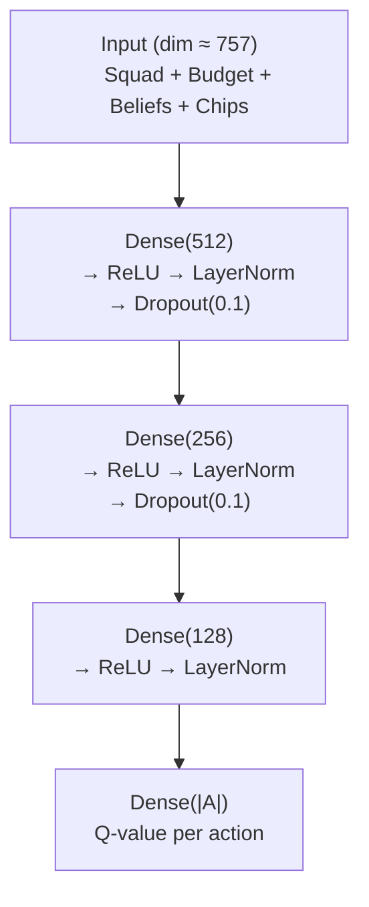

# Chapter 9: Sequential Decision Making — Steps B and C: Multi-Horizon Planning

## 9.1 Introduction

While Thompson Sampling (Chapter 8) provides an elegant Bayesian approach to single-gameweek optimisation, it is inherently **myopic**: it optimises for the immediate gameweek without considering the long-term consequences of decisions. In FPL, however, many decisions have intertemporal effects:

- **Transfer timing**: Using a free transfer now vs. saving it for a double-gameweek.
- **Chip deployment**: Using the Wildcard early to build a strong squad vs. saving it for the fixture swing.
- **Price changes**: Buying a player early before their price rises.
- **Budget management**: Spending budget on a premium player now vs. saving for future transfers.

These strategic considerations require **long-horizon planning**, which is the domain of reinforcement learning and search-based methods.

### 9.1.1 The Three-Step Planning Hierarchy

This chapter completes the three-stage planning hierarchy, which reads as a seamless progression of Bayesian Optimal Control for solving Partially Observable Markov Decision Processes (POMDPs):

```mermaid
graph LR
    A["Chapter 7
    Posterior Inference"] --> B["Belief States
    {b_j^(s)(t)}"]
    B --> C["Chapter 8: Step A
    Thompson Sampling
    (Myopic, 1-GW)"]
    C --> D["Ch 8.8: Step B
    TS + MCTS
    (3-5 GW lookahead)"]
    C --> E["Sections 9.4-9.7: Step C
    DDQN
    (Full season, learned)"]
```**Figure 9.0:** The narrative arc. MCMC inference (Chapter 7) produces belief states that feed all three decision engines. Thompson Sampling (Chapter 8) is Step A — myopic but optimal for single-GW. TS+MCTS (Chapter 8, Section 8.8) is Step B — explicit multi-GW scenario planning. DDQN (Sections 9.5–9.8) is Step C — neural approximation for the full 38-game horizon.

The three steps are:

- **Step A (Chapter 8)**: Optimise exactly for the next gameweek. Thompson Sampling samples from the posterior belief states and solves a deterministic knapsack. It is myopic but highly interpretable and handles FPL constraints exactly.
- **Step B (Chapter 8, Section 8.8)**: Simulate explicit, multi-gameweek transfer sequences by expanding a search tree over sampled posteriors. Thompson Sampling coupled with Monte Carlo Tree Search (TS+MCTS) enables lookahead planning over a 3–5 gameweek horizon, ideal for chip timing and transfer saving strategies.
- **Step C (Sections 9.5–9.8)**: When tree-search becomes computationally explosive (e.g., over a 38-game horizon, where MCTS scales as $O(b^d)$), approximate long-term FPL values using neural networks. The Double Deep Q-Network (DDQN) learns a generalised value function that maps belief-state-augmented representations to long-term value estimates in $O(1)$ forward pass time.

By structuring the decision-making this way, the dissertation reads as a single, cohesive masterclass in solving POMDPs in highly stochastic environments, with FPL serving merely as the testing ground. Rather than a disjointed leap from Bayesian statistics to a black-box neural network, the narrative is a seamless progression: **representation** (belief states from MCMC), **myopic optimisation** (TS), **explicit lookahead** (TS+MCTS), and **learned approximation** (DDQN).

### 9.1.2 Chapter Structure

The remainder of this chapter is organised as follows. Section 9.2 compares the three decision engines. Section 9.3 formalises the POMDP and belief-state MDP. Section 9.4 introduces the latent-state MDP and Bellman equation. Sections 9.5–9.8 develop the DDQN (Step C), including network architecture, the Boltzmann policy, and entropy-regularised control. Sections 9.10–9.12 cover Mean-Field Games, Mean-Field Control, and the summary.

## 9.2 Comparison with TS+MCTS and DDQN: The Planning Hierarchy

The comparison between Thompson Sampling and the methods developed in Chapter 9 is not a matter of which is universally "better" — rather, each method occupies a distinct position in the planning hierarchy:

| Aspect | Thompson Sampling (Step A) | TS+MCTS (Step B) | DDQN (Step C) |
|--------|---------------------------|------------------|---------------|
| **Core idea** | Model outcome uncertainty; sample and optimise | Simulate multi-GW sequences over sampled posteriors | Learn long-term action values via neural approximation |
| **Planning horizon** | 1 gameweek (myopic) | 3–5 gameweeks (explicit lookahead) | Full season (learned generalization) |
| **Exploration** | Natural (posterior uncertainty) | Implicit (world sampling + tree search) | Explicit (Boltzmann policy, MaxEnt RL) |
| **Computational cost** | Low (sampling + MILP) | Medium (tree expansion, rollouts) | Low at inference (single forward pass) |
| **Interpretability** | High (posterior distributions) | High (explicit scenario trees) | Low (black-box Q-values) |
| **Constraint handling** | Exact (MILP, Chapter 10) | Exact (constrained action at each node) | Approximate (action masking) |
| **Best use case** | Captaincy, single-GW transfers | Chip timing, transfer saving | Full-season squad building |

**Thompson Sampling** (Step A) is preferred when interpretability, stability, and exact constraint handling are priorities. It solves the single-gameweek problem optimally but cannot plan across multiple gameweeks.

**TS+MCTS** (Step B, Chapter 8, Section 8.8) extends Thompson Sampling's horizon by building a search tree over transfer sequences, simulating multiple future gameweeks under sampled belief states. This is ideal for high-stakes tactical decisions like Wildcard deployment or Bench Boost timing, where the consequences unfold over 3–5 gameweeks.

### 9.2.1 Comparison with DDQN: Ablation 2

Chapter 12, Ablation 2 (Section 12.5.2) directly compares TS+MCTS against DDQN across several metrics:

| Metric | TS+MCTS (Step B) | DDQN (Step C) |
|--------|-------------------|---------------|
| Cumulative season points | — | — |
| Transfer efficiency (pts per transfer) | — | — |
| Chip timing value (pts vs average) | — | — |
| Inference time per decision | Seconds–minutes | Milliseconds |
| Interpretability | High (explicit scenario trees) | Low (black-box Q-values) |

The hypothesis is that:
- **TS+MCTS excels** at single-GW optimisation and explicit scenario planning (chip timing, transfer sequences), producing smoother, more interpretable decisions.
- **DDQN excels** at learned generalised long-horizon value, handling the full 38-game season efficiently and capturing complex patterns (e.g., price change anticipation, fixture difficulty swings) that are difficult to encode in MCTS rollouts.

The complementary strengths of these two methods justify their inclusion as separate steps (B and C) in the planning hierarchy.

**DDQN** (Step C, Chapter 9) becomes necessary when the planning horizon extends to the full 38-game season. MCTS scales exponentially with horizon length ($O(b^d)$), making it intractable beyond $d \approx 5$. DDQN learns a generalised value function that approximates the optimal long-horizon policy in $O(1)$ forward pass time, at the cost of reduced interpretability and approximate constraint handling.

Together, these three methods form a complementary toolkit: TS for immediate decisions, TS+MCTS for medium-horizon tactical planning, and DDQN for long-term strategic squad building.

## 9.3 The POMDP Formulation

### 9.3.1 Full POMDP Definition

The FPL problem is formally a Partially Observable Markov Decision Process (POMDP), defined by the 7-tuple $(\mathcal{S}, \mathcal{A}, \mathcal{T}, \mathcal{R}, \Omega, \mathcal{O}, \gamma)$. This formulation aligns with the approach of Blau et al. (2022), who demonstrated that sequential decision problems with Bayesian uncertainty can be transformed into MDPs solvable with deep RL, handling both discrete action spaces and black-box probabilistic models.

- **$\mathcal{S}$ (State space)**: The true latent form states of all players, combined with the manager's squad, budget, and chip availability.
- **$\mathcal{A}$ (Action space)**: The combinatorial set of transfers, lineup selections, captaincy choices, and chip deployments.
- **$\mathcal{T}$ (Transition function)**: $P(s_{t+1} \mid s_t, a_t)$, the probability of transitioning to state $s_{t+1}$ given state $s_t$ and action $a_t$.
- **$\mathcal{R}$ (Reward function)**: $R(s_t, a_t)$, the expected FPL points (minus transfer costs) for taking action $a_t$ in state $s_t$.
- **$\Omega$ (Observation space)**: The observable player statistics (goals, assists, minutes, etc.).
- **$\mathcal{O}$ (Observation function)**: $P(o_{t+1} \mid s_{t+1})$, the probability of observing $o_{t+1}$ given state $s_{t+1}$.
- **$\gamma$ (Discount factor)**: $\gamma \in (0, 1]$, weighting future vs. immediate rewards.

### 9.3.2 Partial Observability

The key source of partial observability is the **latent form state** $z_{j,t}$ for each player. The manager does not observe $z_{j,t}$ directly; instead, they observe $x_{j,t} \sim \mathcal{N}(\mu_{z_{j,t}}, \Sigma_{z_{j,t}})$. The HDP-HMM provides the belief state:

$$b_t = \left( P(z_{j,t} = k \mid x_{j,1:t}) \right)_{j=1,\ldots,N; \, k=1,\ldots,K}.$$

This belief state is computed by the MCMC inference methods of Chapter 7 (Section 7.9). Critically, **the belief state $b_t$ is not a point estimate** — it is a full distribution over latent form states, capturing both the agent's best estimate of each player's form and the epistemic uncertainty about that estimate.

### 9.3.3 Belief-State MDP

A POMDP can be converted to a fully observable MDP by using the belief state $b_t$ as the state. The **belief-state MDP** is defined by:

- **State**: $b_t$ (the belief distribution over latent form states for all players, augmented with squad, budget, chips).
- **Action**: $a_t$ (transfers, lineup, captain, chip).
- **Transition**: $P(b_{t+1} \mid b_t, a_t)$, induced by the HDP-HMM transition matrices and the Bayesian belief update.
- **Reward**: $R(b_t, a_t) = \mathbb{E}_{s \sim b_t}[R(s, a_t)]$.

The value function for the belief-state MDP is:

$$V(b_t) = \max_{a_t} \left( R(b_t, a_t) + \gamma \cdot \mathbb{E}_{b_{t+1} \mid b_t, a_t}[V(b_{t+1})] \right).$$

All three decision engines in the planning hierarchy — Thompson Sampling (Chapter 8), TS+MCTS (Chapter 8, Sections 8.10–8.11), and DDQN (this chapter) — operate on this belief-state MDP. They differ only in how they approximate the value function $V(b_t)$:
- **TS** evaluates $V(b_t)$ by sampling one belief state and solving the immediate reward $R(b_t, a_t)$.
- **TS+MCTS** approximates $V(b_t)$ by explicitly expanding a search tree over future belief states.
- **DDQN** learns a parametric approximation $V(b_t; \theta)$ via neural network training.

## 9.4 The Latent-State MDP

### 9.4.1 Simplification to Latent States

For tractability, the belief-state MDP is simplified to a **latent-state MDP** where the state is the most likely form state for each player:

$$s_t = \left( \arg\max_k P(z_{j,t} = k \mid x_{j,1:t}) \right)_{j \in S_t}.$$

This is a hard assignment approximation of the full belief state. The action space is restricted to transfers (swap players in/out of the squad).

### 9.4.2 Transition Dynamics

The transition function is given by the HDP-HMM transition matrices:

$$P(s_{t+1} = \ell \mid s_t = k, a_t) = \pi_{k,\ell}(a_t),$$

where $\pi_{k,\ell}(a_t)$ is the probability of transitioning from form state $k$ to form state $\ell$ under action $a_t$ (Section 6.4).

### 9.4.3 Reward Function

The reward for being in state $k$ and taking action $a$ is:

$$r(k, a) = w^\top \mu_k - \lambda \cdot c(a),$$

where:
- $w^\top \mu_k$ is the expected FPL points for a player in form state $k$ (linear mapping from features to points).
- $c(a)$ is the cost of action $a$ (e.g., 4 points per extra transfer).
- $\lambda$ is a cost scaling parameter.

### 9.4.4 Bellman Optimality Equation

The optimal action-value function $Q^*(k, a)$ satisfies the Bellman equation:

$$Q^*(k, a) = r(k, a) + \gamma \sum_{\ell=1}^K \pi_{k,\ell}(a) \cdot \max_{a'} Q^*(\ell, a').$$

This is a system of $K \cdot |\mathcal{A}|$ equations in $K \cdot |\mathcal{A}|$ unknowns. For small $K$ and $|\mathcal{A}|$, it can be solved exactly via value iteration or policy iteration. For large action spaces (as in FPL), function approximation is employed.

### 9.4.5 Posterior Uncertainty in the Bellman Equation

Integrating over the HDP posterior, the Bellman equation becomes:

$$Q(k, a) = \mathbb{E}_{\boldsymbol{\pi}, \mu, \Sigma}\left[ r(k, a) + \gamma \sum_{\ell=1}^K \pi_{k,\ell}(a) \cdot V(\ell) \right],$$

where the expectation is taken with respect to the posterior samples from the MCMC chain. In practice, this is approximated by averaging over $S$ posterior samples:

$$Q(k, a) \approx \frac{1}{S} \sum_{s=1}^S \left( r^{(s)}(k, a) + \gamma \sum_{\ell=1}^K \pi_{k,\ell}^{(s)}(a) \cdot V^{(s)}(\ell) \right).$$

## 9.5 Deep Q-Networks (DQN) — Step C: Neural Approximation for Long-Horizon Value

### 9.5.1 Motivation: Why Neural Approximation?

DDQN addresses this by **learning a generalised value function** that approximates the optimal long-horizon policy in $O(1)$ forward pass time. Instead of explicitly expanding a search tree, the DDQN takes the belief-state-augmented representation as input and directly outputs Q-values for all candidate actions. This is **Step C** in the planning hierarchy — the computational approximation when exact search is intractable.

### 9.5.2 Function Approximation

For the FPL problem, the state space $\mathcal{S}$ and action space $\mathcal{A}$ are too large for tabular Q-learning. A neural network is employed to approximate the Q-function:

$$Q(s, a; \theta) \approx Q^*(s, a),$$

where $\theta$ are the network weights.

The network takes the state representation $s$ as input and outputs a vector of Q-values, one for each possible action $a$:

$$Q(s; \theta) = (Q(s, a_1; \theta), Q(s, a_2; \theta), \ldots, Q(s, a_{|\mathcal{A}|}; \theta)).$$

### 9.5.3 State Representation

The state vector $s_t$ for gameweek $t$ includes:

- **Squad encoding**: A binary vector of length $N$ (all FPL players), with 1s for players in the squad.
- **Budget**: A scalar (remaining budget in £0.1m units).
- **Belief states**: For each player in the squad, the belief vector $b_j(t) \in \mathbb{R}^K$ over form states.
- **Chips available**: A binary vector of length 4 (Wildcard, Free Hit, Bench Boost, Triple Captain).
- **Gameweek number**: A scalar $t \in \{1, \ldots, 38\}$.
- **Free transfers**: A scalar $f_t \in \{1, 2\}$.

Total dimensionality: $N + 1 + 15 \cdot K + 4 + 2 \approx 600 + 1 + 150 + 6 \approx 757$ (for $K = 10$).

### 9.5.4 Training Objective

The DQN is trained by minimising the **Temporal Difference (TD) error**:

$$\mathcal{L}(\theta) = \mathbb{E}_{(s, a, r, s') \sim \mathcal{D}} \left[ \left( r + \gamma \cdot \max_{a'} Q(s', a'; \theta_{\text{target}}) - Q(s, a; \theta) \right)^2 \right],$$

where $\mathcal{D}$ is the experience replay buffer, and $\theta_{\text{target}}$ is the target network (a slowly-updated copy of the online network).

### 9.5.5 Experience Replay

The experience replay buffer $\mathcal{D}$ stores transitions $(s_t, a_t, r_t, s_{t+1})$ from past gameweeks (simulated or real). During training, a minibatch of transitions is sampled uniformly from $\mathcal{D}$ and a gradient step is performed. This breaks the correlation between consecutive samples, stabilising training.

## 9.6 Double DQN (DDQN) — Step C Continued

### 9.6.1 Maximisation Bias

Standard DQN suffers from **maximisation bias**: the same network is used to both select and evaluate the best action in the target:

$$y = r + \gamma \cdot \max_{a'} Q(s', a'; \theta_{\text{target}}).$$

If some action's Q-value is overestimated (due to noise or approximation error), it is likely to be selected by the max operator, perpetuating the overestimation. This leads to systematically optimistic Q-value estimates and suboptimal policies.

### 9.6.2 Decoupled Action Selection and Evaluation

DDQN addresses this by decoupling action selection from evaluation:

$$y = r + \gamma \cdot Q(s', a^*; \theta_{\text{target}}), \quad \text{where } a^* = \arg\max_{a'} Q(s', a'; \theta_{\text{online}}).$$

The **online network** selects the best action, and the **target network** evaluates it. This reduces the overestimation bias and leads to more stable training.

### 9.6.3 Unified Hybrid Training Loop

The full system integrates the HDP-HMM latent state inference with the DDQN training loop, combining belief state estimation with long-horizon Q-value learning. This unified pipeline captures the architecture specified in the original system design:

```
Algorithm: Hybrid HDP-HMM + DDQN Training
Input: Historical FPL data, simulated seasons
Output: Trained Q-network parameters θ, posterior samples {μ_k, Σ_k, π_k}

Initialise:
    Replay buffer D ← empty
    Online network Q_online with weights θ (random)
    Target network Q_target with weights θ' ← θ
    HDP-HMM hyperparameters: γ ~ Gamma(1,1), α ~ Gamma(1,1), K = 10

for episode = 1 to M:
    // Stage 1: Run HDP-HMM inference on player performance data
    Run MCMC (NUTS via NumPyro) on {x_{j,t}} for all players
    Extract belief states: b_j(k) = P(z_j = k | x_j) for each player j

    // Stage 2: Initialise gameweek state
    s_0 ← (squad_encoding, budget, {b_j}_{j∈squad}, chips, gw=1, free_transfers)

    for t = 1 to 38:
        // Stage 3: Select action via Boltzmann policy
        q_vals ← Q_online(s_t; θ)                    // forward pass
        a_t ← sample from softmax(q_vals / τ_t)       // τ_t annealed over season

        // Stage 4: Execute action and observe outcome
        (next_squad, reward) ← env.step(a_t)
        // reward = FPL points gained - λ × transfer_cost

        // Stage 5: Update belief states with new gameweek data
        Run Bayesian update on HDP-HMM with x_{j,t}
        b_j ← updated belief states

        // Stage 6: Construct next state
        s_{t+1} ← (next_squad_encoding, updated_budget, {b_j}, updated_chips, t+1, updated_transfers)

        // Stage 7: Store transition in replay buffer
        D.push(s_t, a_t, reward, s_{t+1}, done=(t==38))

        // Stage 8: Sample minibatch and perform DDQN update
        batch ← D.sample(batch_size)
        for each (s, a, r, s', done) in batch:
            a_best ← argmax_{a'} Q_online(s', a'; θ)     // online selects
            y ← r + γ_ddqn · Q_target(s', a_best; θ') · (1 - done)  // target evaluates
            loss ← (y - Q_online(s, a; θ))²
            θ ← θ - α_lr · ∇_θ loss                       // gradient descent

        // Stage 9: Update target network periodically
        if step mod C == 0:
            θ' ← θ                                         // hard update

    // Stage 10: End-of-episode HDP-HMM full posterior update
    Store posterior samples {μ_k^(s), Σ_k^(s), π_k^(s)} for gameweek t+1
```

Key design points:

- **HDP-HMM runs once per gameweek** (Stages 1 and 5), producing belief states that are fed into the DDQN's state representation (Stages 2 and 6).
- **The DDQN learns to map belief-state-augmented representations to long-term value estimates** (Stage 8).
- **The Boltzmann policy provides smooth exploration** over transfer strategies, with temperature $\tau_t$ annealed from $\tau_{\text{init}} = 2.0$ to $\tau_{\text{final}} = 0.1$ over the season (Stage 3).
- **The DDQN update decouples action selection from evaluation**, using the online network to select $a_{\text{best}}$ and the target network to evaluate it (Stage 8), addressing the maximisation bias of standard DQN.
- **The replay buffer stores experiences across gameweeks and episodes**, enabling the DDQN to learn from historical and simulated data (Stage 7).

This architecture addresses the "Curse of Dimensionality" in large-scale FPL leagues: the HDP-HMM compresses high-dimensional player performance data into low-dimensional belief states, which the DDQN can efficiently process. The MILP layer (Chapter 10) then enforces the rigid squad constraints that the DDQN cannot natively handle.

## 9.7 Network Architecture

### 9.7.1 Q-Network

The Q-network is a feedforward neural network with the architecture shown in Figure 9.1.



**Figure 9.1:** Q-Network architecture for FPL decision-making. Input dimensionality ~757 (600 squad encoding + 1 budget + 150 belief states + 4 chips + 2 metadata). Output dimensionality = number of candidate transfer actions (~100 after pruning to top-ranked players).

Key design choices:
- **LayerNorm**: Stabilises training by normalising activations across features (important for heterogeneous input features).
- **Dropout**: Regularises the network, preventing overfitting to the limited FPL data.
- **Output dimension**: The action space $|\mathcal{A}|$ is restricted to a candidate set of ~100 players (the top-ranked players by expected points), reducing the output from 8,775 possible transfers to a tractable set.

### 9.7.2 Target Network

The target network is an identical copy of the Q-network, updated periodically (every $C = 1000$ steps) via hard update:

$$\theta' \leftarrow \theta.$$

Alternatively, a soft update can be used:

$$\theta' \leftarrow \tau \cdot \theta + (1 - \tau) \cdot \theta', \quad \tau = 0.001.$$

### 9.7.3 Implementation Framework Considerations

The DDQN can be implemented in PyTorch or JAX. PyTorch offers a dynamic computation graph, extensive community support, and RL libraries (TorchRL), making it well-suited for rapid development and debugging. JAX offers superior performance through JIT compilation and TPU support, with a functional paradigm that eliminates state-mutation bugs. For this project, PyTorch is the recommended choice for the DDQN component, while JAX (via NumPyro) is used for the HDP-HMM MCMC inference where its performance advantage is most significant. Detailed framework-specific implementation notes, including code scaffolding and dependency management, are deferred to an implementation appendix.

## 9.8 Boltzmann Policy

### 9.8.1 Definition

The Boltzmann (softmax) policy converts Q-values into a probability distribution over actions:

$$\pi(a \mid s) = \frac{\exp(Q(s, a) / \tau)}{\sum_{a'} \exp(Q(s, a') / \tau)},$$

where $\tau > 0$ is the temperature parameter.

### 9.8.2 Temperature Control

The temperature $\tau$ controls the exploration-exploitation trade-off:

- **High $\tau$** (e.g., $\tau = 10$): All actions have nearly equal probability → random exploration.
- **Low $\tau$** (e.g., $\tau = 0.1$): The action with the highest Q-value has probability near 1 → greedy exploitation.
- **Intermediate $\tau$** (e.g., $\tau = 1.0$): Smooth exploration, favouring high-Q actions but occasionally trying alternatives.

### 9.8.3 Temperature Annealing

The temperature $\tau$ is annealed over the season to transition from exploration to exploitation:

$$\tau_t = \tau_{\text{init}} \cdot \left( 1 - \frac{t}{38} \right) + \tau_{\text{final}} \cdot \frac{t}{38},$$

where $\tau_{\text{init}} = 2.0$ and $\tau_{\text{final}} = 0.1$. Early gameweeks explore broadly; late gameweeks exploit the learned policy.

### 9.8.4 The Principled Maximum Entropy Objective vs $\epsilon$-Greedy

The standard $\epsilon$-greedy approach is a purely arbitrary heuristic: it is overly greedy most of the time and explores uniformly at random otherwise. This is highly problematic in FPL's stochastic environment, where uniform exploration might suggest transferring in a clearly suboptimal player, causing catastrophic rank drops. The question "why explore 10% of the time?" has no principled answer under $\epsilon$-greedy.

Rather than being a simple exploratory hack, the **principled Boltzmann policy** emerges naturally as the exact, mathematically optimal solution to the **Maximum Entropy Reinforcement Learning (MaxEnt RL)** objective:

$$\max_{\pi} \mathbb{E} \left[ \sum_{t=0}^\infty \gamma^t \left( R(s_t, a_t) + \tau \mathcal{H}(\pi(\cdot \mid s_t)) \right) \right]$$

By explicitly maximizing the reward *plus* the Shannon entropy of the policy $\mathcal{H}$, the agent avoids premature commitment to noisy estimates. It acts cautiously across all plausible latent "worlds" sampled from the HDP-HMM posterior. Thus, the Boltzmann distribution is not just an exploration trick — it is the mathematically correct method for hedging risk and optimally balancing reward exploitation against structural uncertainty.

The agent explores not because randomness was hardcoded, but because it **optimizes an objective function that inherently demands hedging against the multimodal uncertainty** of player forms. This is a critical distinction: $\epsilon$-greedy explores arbitrarily; the Boltzmann policy explores optimally with respect to the MaxEnt objective.

This is empirically validated in Chapter 12, Ablation 8 (Section 12.5.8), comparing the principled Boltzmann policy against $\epsilon$-greedy on cumulative points, exploration diversity (unique players selected), and risk-adjusted returns. The hypothesis is that $\epsilon$-greedy is overly greedy and explores arbitrarily, leading to suboptimal transfers in FPL's stochastic environment, while the principled Boltzmann policy provides superior performance in navigating multi-modal posterior beliefs.

## 9.9 Entropy-Regularised Control

### 9.9.1 Soft Q-Learning

An alternative to the Boltzmann policy is **entropy-regularised reinforcement learning**, which adds an entropy bonus to the reward:

$$\mathcal{J}(\pi) = \mathbb{E}_{\pi}\left[ \sum_{t=0}^\infty \gamma^t \left( R(s_t, a_t) + \lambda \cdot \mathcal{H}(\pi(\cdot \mid s_t)) \right) \right],$$

where $\mathcal{H}(\pi) = -\sum_a \pi(a \mid s) \log \pi(a \mid s)$ is the policy entropy, and $\lambda > 0$ controls the regularisation strength.

### 9.9.2 Soft Bellman Equation

The soft Q-function satisfies the **soft Bellman equation**:

$$Q_{\text{soft}}(s, a) = R(s, a) + \gamma \cdot \mathbb{E}_{s'} \left[ V_{\text{soft}}(s') \right],$$

where the soft value function is:

$$V_{\text{soft}}(s) = \log \sum_a \exp(Q_{\text{soft}}(s, a) / \lambda).$$

This is the **LogSumExp** operator, which is a smooth approximation of the max operator. When $\lambda \to 0$, it converges to $\max_a Q(s, a)$.

### 9.9.3 K-Values (Knowledge Values)

O'Donoghue (2021) introduced the concept of **K-values** in the context of Variational Bayesian Reinforcement Learning, which compress both the expected future rewards and the epistemic uncertainty into a single value. This is achieved by endowing the agent with a risk-seeking exponential utility function, leading to an optimistic Bellman operator that replaces the standard max operator with a soft-max and incorporates a 'bonus' for state-action visitation.

In this framework:

$$K(s, a) = Q(s, a) + \lambda \cdot \mathcal{H}(\pi(\cdot \mid s)).$$

The agent follows a Boltzmann policy over the K-values, with a temperature schedule that ensures sublinear Bayes regret. O'Donoghue (2021) proved that this achieves a Bayes regret bound of $O(L^{3/2} \sqrt{SAT})$, matching the best-known bound for Thompson Sampling up to logarithmic factors.

## 9.10 Mean-Field Games for Classical Leagues

### 9.10.1 Formal MFG Setup

Consider the population of FPL managers as a continuum of agents indexed by $i \in [0, 1]$. Each agent $i$ has a state $s^i_t$ at time $t$, representing their squad composition, budget, available chips, and belief states over player forms. The agent chooses an action $a^i_t$ to maximise:

$$
\begin{aligned}
J^i(a^i) = \mathbb{E} \bigg[ &\int_0^T e^{-\rho t} \left( r(s^i_t, a^i_t, m_t) - \lambda \cdot c_{\text{transfer}}(a^i_t) \right) dt \\
&+ e^{-\rho T} g(s^i_T, m_T) \bigg],
\end{aligned}
$$

where:
- $r(s^i_t, a^i_t, m_t)$ is the running reward (expected FPL points), which depends on the agent's state, action, and the **mean field** $m_t$ (the distribution of states across the population).
- $c_{\text{transfer}}(a^i_t)$ is the transfer cost.
- $m_t$ is the population distribution over states at time $t$: $m_t = \text{Law}(s^i_t)$ for almost all $i$.
- $g(s^i_T, m_T)$ is a terminal reward capturing the rank-based utility at the season end.
- $\rho = -\log \gamma$ is the continuous-time discount rate.

The mean field enters the reward through two primary channels:

1. **Price dynamics**: Player price changes are driven by net transfer activity. Let $n_p(t)$ denote the number of managers owning player $p$ at time $t$. The price change is:

   $$\begin{aligned}
   \Delta \text{price}_p(t) &= f\left( \sum_{i} \mathbb{I}(p \in a^{i,\text{in}}_t) - \sum_{i} \mathbb{I}(p \in a^{i,\text{out}}_t) \right) \\
   &\approx f\left( \int \mathbb{I}(p \in a^{\text{in}}_t) \, dm_t(a) - \int \mathbb{I}(p \in a^{\text{out}}_t) \, dm_t(a) \right).
   \end{aligned}$$

   This is a **mean-field interaction**: the aggregate transfer decisions of the population drive price changes, which in turn affect each manager's budget constraint.

2. **Ownership pressure**: Highly-owned players ("template" picks) create implicit pressure. The rank-based utility is:

   $$U_{\text{rank}}(R_{\text{total}}) \approx \Phi\left( \frac{R_{\text{total}} - \mu_m}{\sigma_m} \right),$$

   where $\mu_m, \sigma_m$ are the mean and standard deviation of the population's total points, and $\Phi$ is the standard normal CDF.

### 9.10.2 MFG Equilibrium: Coupled HJB-FP System

A Nash equilibrium in the mean-field limit is characterised by a coupled system of two partial differential equations:

1. **Hamilton-Jacobi-Bellman (HJB) equation** (backward in time): For a given mean field flow $(m_t)_{t \in [0,T]}$, each agent solves their optimal control problem. The value function $V(s, t)$ satisfies:

   $$
   \begin{aligned}
   -\frac{\partial V}{\partial t}(s, t) &= \sup_{a \in \mathcal{A}} \left\{ r(s, a, m_t) + \mathcal{L}^a V(s, t) \right\}, \\
   V(s, T) &= g(s, m_T),
   \end{aligned}
   $$

   where $\mathcal{L}^a$ is the generator of the state dynamics under action $a$.

2. **Fokker-Planck (FP) equation** (forward in time): Given the optimal policy $a^*(s, t)$ derived from the HJB equation, the population distribution evolves according to:

   $$\frac{\partial m}{\partial t}(s, t) = (\mathcal{L}^{a^*})^* m(s, t), \quad m(s, 0) = m_0(s),$$

   where $(\mathcal{L}^{a^*})^*$ is the adjoint of the generator, and $m_0$ is the initial population distribution.

A **mean-field equilibrium** is a fixed point: the mean field $m_t$ that agents anticipate when solving the HJB equation is precisely the mean field generated by the population following the resulting optimal policy.

### 9.10.3 Strategic Implications

The MFG framework reveals several strategic insights for classical FPL leagues:

- **Differential strategy**: When the population mean field concentrates on "template" players, the optimal individual response may involve selecting differentials (low-ownership, high-variance players).
- **Transfer timing**: An agent who anticipates a surge in demand for a player can buy early, capturing price appreciation — a form of **arbitrage on the mean field**.
- **Chip deployment**: The optimal timing of chips depends on the mean field. Deploying Bench Boost during a gameweek with many double fixtures is only valuable if the population's average chip deployment creates a relative advantage.

### 9.10.4 MFG Equilibrium as a DDQN Regulariser

The mean-field equilibrium policy $\pi_{\text{MFG}}$ provides a population-level strategy that can regularise the DDQN's learning. Specifically, a penalty is added for deviating from the mean-field strategy:

$$\mathcal{L}_{\text{MFG}}(\theta) = \mathcal{L}_{\text{TD}}(\theta) + \lambda_{\text{MFG}} \cdot \text{KL}(\pi_\theta(\cdot \mid s) \parallel \pi_{\text{MFG}}(\cdot \mid s)),$$

where $\lambda_{\text{MFG}}$ controls the regularisation strength. This encourages the DDQN to learn a policy close to the population equilibrium, while still allowing individual deviations (differential picks).

The effect of the mean-field coupling strength is evaluated empirically in Chapter 12, Ablation 10 (Section 12.5.10), which sweeps the coupling parameter $\omega \in \{0, 0.1, 0.3, 0.5, 0.8\}$. At $\omega = 0$, the model reduces to a standard HDP-HMM; higher values of $\omega$ pull transitions toward the population average. The ablation evaluates prediction accuracy, belief state KL divergence from the population, and the number of active clusters.

### 9.10.5 Solving the MFG

The MFG equilibrium is computed by iterating between:

1. **HJB step**: Solve the HJB equation for the value function $V(s, t)$ given the current mean field $m_t$.
2. **FP step**: Update the mean field $m_t$ by simulating the population following the optimal policy derived from $V$.

This is repeated until convergence (the mean field predicted by the HJB matches the mean field generated by the FP).

## 9.11 Mean-Field Control for Draft and H2H Leagues

### 9.11.1 MFC Formulation

While MFGs model competitive, non-cooperative equilibria, **Mean-Field Control (MFC)** addresses settings where a single manager optimises their decisions while being constrained by the population distribution $\mu_t$:

$$\max_{\pi} \; \mathbb{E}_{\pi}\left[ \sum_{t=0}^T \gamma^t \left( R(s_t, a_t, \mu_t) + \lambda \cdot \mathcal{H}(\pi(\cdot \mid s_t)) \right) \right],$$

where $\mathcal{H}(\pi) = -\sum_a \pi(a \mid s) \log \pi(a \mid s)$ is the policy entropy. The key distinction from MFG: the agent **internalises** the effect of the population distribution on their constraints but does not compete in a Nash equilibrium against strategic opponents.

The population distribution $\mu_t$ enters through:
- **Player availability** (Draft): $\mu_t(p) = \mathbb{P}(p \text{ is owned})$ determines which players can be acquired. In a Draft league, the scarcity of players creates a direct coupling — each player $p \in \mathcal{P}$ can be assigned to at most one manager.
- **Opponent strength** (H2H): $\mu_t$ determines the distribution of opponent scores. The objective is gameweek-level victory: $r_t = 3 \cdot \mathbb{I}(X_t > Y_t) + 1 \cdot \mathbb{I}(X_t = Y_t)$, where $Y_t \sim F_{\text{opp}}(t)$ is estimated from the population.

### 9.11.2 Unified Decision Framework

The unified framework combines all four decision engines (Thompson Sampling, TS+MCTS, DDQN, MFG/MFC) into a single pipeline:

1. **HDP-HMM** computes belief states $b_j(t)$ for all players.
2. **Context determination**: Classical league → MFG; Draft/H2H → MFC; Single-gameweek → Thompson Sampling (Step A); Multi-gameweek tactical → TS+MCTS (Step B); Full-season strategic → DDQN (Step C).
3. **Decision engine** computes action values or sampled points.
4. **MILP/Knapsack** solves the constrained optimisation problem (Chapter 10).
5. **Action execution**: Transfers, lineup, captain, chip.

The choice of decision engine depends on the context:
- **Classical league, late season**: MFG (population equilibrium is stable).
- **Draft league, early season**: MFC (resource scarcity is critical).
- **Captaincy choice**: Thompson Sampling (Step A, myopic, interpretable).
- **Chip timing**: TS+MCTS (Step B, Chapter 8, Section 8.8).
- **Full-season squad building**: DDQN (Step C, long-horizon planning).

## 9.12 Summary

This chapter has developed the DDQN approach to FPL sequential decision-making as **Step C** in the three-stage planning hierarchy, grounded in the Bellman equation formulation for the latent-state MDP. The DDQN addresses the maximisation bias of standard DQN by decoupling action selection and evaluation. The Boltzmann policy provides smooth, intelligent exploration, derived as the optimal solution to the Maximum Entropy RL objective rather than an arbitrary heuristic. Entropy-regularised control and K-values offer a theoretical foundation for soft-max operators. The MFG and MFC frameworks integrate population-level dynamics into the decision-making process, yielding a unified framework that adapts to the competition format.

Together with Thompson Sampling (Step A, Chapter 8) and TS+MCTS (Step B, Chapter 8, Section 8.8), the DDQN completes a three-stage planning hierarchy that progresses seamlessly from Bayesian posterior inference (Chapter 7) through myopic optimisation, explicit multi-gameweek lookahead, and learned long-horizon value approximation — forming a cohesive masterclass in solving POMDPs in highly stochastic environments.

The next chapter addresses the constrained optimisation layer — the knapsack problem, MILP formulations, and the Contextual MAB for captaincy selection.
