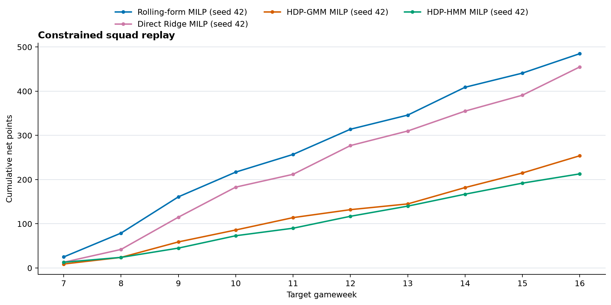

# Walk-forward next-gameweek study

## Purpose and research question

This experiment builds the first reproducible research-first comparison for the sequential FPL project. It asks two separate questions:

1. Do the latent-state challengers improve forecasts of player points in the next gameweek over a lagged rolling-form baseline?
2. Do any forecast differences improve a constrained squad policy after transfers, available bank, free transfers, hits, lineup choice, captaincy, and automatic substitutions are applied?

The first question is the primary predictive evaluation. Squad points are a downstream decision result and are not a substitute for forecast accuracy. The thesis remains the conceptual treatment; the chapters now carry a narrow correction to the Negative-Binomial support caveat and posterior parameterization, while this report records implementation evidence.

## Models and their relationship to the thesis

The core runner contains three predictors. A supplementary, sampler-free pass
adds a direct feature-to-points regression challenger after the core run
completes; it writes to a separate directory and leaves the original HDP
ledger unchanged. The four-predictor comparison is:

| Predictor | Forecast construction | Role in the comparison |
| --- | --- | --- |
| `rolling_form` | Mean points over the five preceding gameweeks; unobserved weeks after first appearance contribute zero | Transparent, non-Bayesian reference |
| `direct_ridge` | Fold-local Ridge regression from the same nine lagged features to earlier realized points; fixed `alpha=1.0` | Direct supervised challenger; accepts signed point targets |
| `hdp_gmm` | Gaussian emissions over lagged features; posterior mixture probabilities are mapped to earlier points | Independent latent-state challenger linked to [Chapter 5](../thesis/chapters/chapter_05_hdp_gmm_gaussian_wishart.md) |
| `hdp_hmm` | Gaussian emissions and shared, action-conditioned transition rows; filtered state probabilities are mapped to earlier points | Temporal latent-state challenger linked to [Chapter 6](../thesis/chapters/chapter_06_hdp_hmm_temporal_dynamics.md) |

The model priors share global stick-breaking weights with the player-specific GMM weights and HMM transition rows. In the finite GMM approximation, each player's weight vector is drawn directly as `Dirichlet(alpha * beta)`, the finite-dimensional DP marginal; this avoids an independent local-stick parameterization. The HMM draws each transition row from the same shared-base form. Both use a truncated state space, Gaussian emissions, and Wishart priors over full precision matrices. The Normal–Inverse–Wishart specification in Chapter 5 uses degrees of freedom `D + 2`; its equivalent precision-Wishart prior therefore uses `D + 2`, which is now reflected in the model code.

This alignment concerns the shared-base prior only; it does not make the current modules a complete implementation of every inference algorithm described in the thesis. Chapter 5 derives collapsed Gibbs/NIW updates, while the current `src/models/hdp_gmm.py` module uses NumPyro NUTS over continuous parameters and integrates the finite mixture assignments out exactly in the likelihood. Chapter 6 explains FFBS and mean-field extensions, while `src/models/hdp_hmm.py` uses a masked forward likelihood inside NUTS and does not implement backward state sampling or mean-field coupling. This runner adds the point-reward mapping and forecast protocol around those current model interfaces. NUTS targets an acceptance probability of 0.95 by default; each run records divergences and mean acceptance probability, which must be checked before treating a fold's forecasts as usable. The thesis remains the conceptual treatment; source behavior and this experiment report define what was run.

The Vaastav archive has no manager-action sequence. The HMM therefore receives one neutral action category. The action-conditioned interface is exercised, but action effects cannot be estimated in this study. The thesis's mean-field extension and reinforcement-learning decision layer are also outside this experiment.

Neither latent model emits FPL points directly. In each fold, posterior state probabilities on the earlier training rows are used to estimate a state-conditioned points reward. The estimate is the responsibility-weighted mean of prior points, smoothed toward the training-wide mean with a prior mass of two observations. The current implementation first averages training and target responsibilities over retained posterior draws, estimates state rewards from the averaged training responsibilities, and then multiplies the target responsibility vector by those reward means. This plug-in mapping is an explicit bridge from the feature-state models to the points objective; it is not a draw-by-draw posterior predictive distribution for points and does not capture points uncertainty.

The `direct_ridge` challenger maps lagged features to points without latent states. Each target fold fits `StandardScaler` and `Ridge(alpha=1.0)` on all earlier player-gameweek feature rows and their realized points labels; it then predicts the saved target-player cohort. The regularization value is fixed rather than selected on target outcomes, and predictions remain continuous and unclipped. This is a direct conditional-mean baseline, not a probabilistic points-emission model. It uses all available earlier player-week rows, whereas the HDP posterior fit uses the fixed 24-player GW1 cohort; that training-scope difference is recorded in comparison metadata.

The thesis already sketches a Negative-Binomial points emission and a product base measure in Chapter 5, and a feature-to-points mapping in Chapter 9. Those are conceptual proposals, not part of the core Gaussian feature likelihood implemented by the current HDP modules. A standard Negative Binomial cannot represent negative raw FPL scores. In the exact 2023-24 source archive used here (SHA-256 `e9c09c8856f1c86b4f920f46ddd5033af83409439dfda53be925df2a3e7c8a9e`), all 29,725 fixture rows have points; 165 are negative, with a minimum of -4. The project loader aggregates fixture rows into 28,742 player-gameweek rows, including 162 negative scores (minimum -4) and 18,344 zero scores; the aggregated-table mean is 1.088 and variance is 5.618. The over-dispersion observation alone does not make the ordinary Negative Binomial valid for this signed target. `direct_ridge` is used as the first direct-points challenger because it predicts the signed conditional mean; a future HDP outcome emission needs a specified likelihood with support for signed scores and a defined joint or conditional relationship to the feature emissions.

The GMM uses the posterior player-specific mixture for the fixed fit cohort and the global mixture for other players. The HMM uses the fitted shared transition model and filters each target player's lagged feature history; a player without a history starts from the global weights. The fit cohort is sampled by position from GW1 with a fixed seed and reused across folds. This limits NUTS runtime and means the study is a cohort pilot, rather than an all-player posterior fit.

Sequence padding is fold-local: target GW *t* uses at most *t - 2* training snapshots per player (GW2 through GW*t-1). The HMM does not scan empty future gameweeks, and the GMM likelihood contains only training snapshots, not padded future rows. Masks retain shorter player histories where needed.

## Point-in-time protocol

Let `t` be the target gameweek and `u` an earlier training gameweek. For each target fold:

1. Construct every target feature from archive rows with gameweek strictly less than `t`. No target-gameweek outcome is used to fit, scale, or predict that fold.
2. Reconstruct earlier examples as historical snapshots: the feature row for `u` uses only rows before `u`, while its label is the realized points in `u`. Training labels therefore satisfy `u < t`.
3. Refit the standard scaler on the fold's earlier training rows only. Apply that scaler to training rows, target rows, and the HMM's earlier player history.
4. Fit the GMM and HMM using the same cohort, feature columns, cutoff, and fold-specific transformation. The deterministic seed is derived from the study seed and target gameweek.
5. Append the target fold to `predictions.csv`, flush the file, and call `fsync` before advancing to the next fold. The forecast-generation function has no target-outcome lookup.
6. Only after all requested folds have been persisted does the evaluator read target outcomes and create scored predictions and metrics. The orchestrator performs this forecast scoring before starting the squad replay. Inside replay, each decision uses the as-of feature panel and saved predictions; `outcomes_for_gameweek` is called after `make_decision` returns, to score that decision and update the simulated state. Thus the forecast ledger is persisted before forecast scoring, and the replay strategy cannot see the target-week outcome when selecting its squad.

Each core forecast row records its target week, feature cutoff (`t - 1`), player ID, position, price, predictor values, cohort membership, and number of earlier training rows. `candidate_fresh` marks players whose latest archive observation falls within the configured stale window. Forecasts are also generated for older archived players so the constrained replay can assign a score to a held player retained by the manager simulation; forecast-accuracy metrics use only the freshness-filtered pool, common to all predictors in that comparison. The supplementary direct-points pass requires an exact one-to-one match to the saved player-week keys, persists `direct_ridge_predictions.csv` and `predictions_with_direct.csv` in its own output directory, and only then scores target outcomes.

This is an auditable chronological boundary, not proof that the archive reproduces what was visible at an official FPL deadline. Vaastav's merged gameweek rows are not dated deadline snapshots. The archive also lacks official player availability, price-at-deadline, and manager-action histories. Eligibility and features remain archive-based proxies.

## Historical data and test-fixture boundary

The study input is the real Vaastav Anand 2023-24 merged gameweek archive linked below, not generated player data. The screened GW7 diagnostic and full-season walk-forward run read `fpl_2023_24_merged_gw.csv`; the project loader produced 28,742 aggregated player-gameweek rows across GW1–GW38 and 865 unique players. Its SHA-256 is `e9c09c8856f1c86b4f920f46ddd5033af83409439dfda53be925df2a3e7c8a9e` and is recorded in run metadata alongside the source URL. The source CSV is kept outside the repository so the research artifacts do not duplicate the archive.

Small synthetic or hand-built fixtures appear only in unit tests. They isolate contracts such as point-in-time cutoffs, posterior-array shapes, probability normalization, diagnostic-gate behavior, and figure generation. Those fixtures are not inputs to the historical forecasts, scored metrics, or squad replay. The real-data study artifacts and test-fixture checks must be reported separately.

## Feature and outcome construction

The existing point-in-time feature builder produces the following inputs from the preceding five-week window:

| Feature | Definition used in the study |
| --- | --- |
| `form_points` | Mean total points per gameweek in the window, with missing weeks after first appearance set to zero |
| `form_std` | Sample standard deviation of those weekly points |
| `xgi_points` | Expected goal/assist and clean-sheet points proxy plus recent appearance contribution |
| `appearance_probability` | Fraction of window weeks with positive minutes |
| `expected_minutes` | Mean minutes per week, including zero-minute weeks |
| Position indicators | One-hot GK, DEF, MID, and FWD columns |

Inputs are converted to finite numeric values and standardized within each fold. The rolling-form comparator uses the same `form_points` feature, while the latent-state models receive all nine numeric columns.

Vaastav fixture rows are aggregated to player-gameweek rows by summing points, minutes, expected goals, expected assists, and clean sheets. Double-gameweek totals therefore remain combined. Price and identity metadata use the final fixture row in that week. Missing player-gameweek rows contribute zero points when constructing the rolling window and training labels.

## Predictive evaluation

All predictors are scored on identical fresh-candidate player-gameweek observations. The report includes:

- mean absolute error (MAE),
- root mean squared error (RMSE),
- mean signed error (`prediction - actual`), and
- Spearman rank correlation between predicted and realized points.

Metrics are reported overall, by gameweek, and by position. MAE and RMSE quantify point error; signed error exposes systematic over- or under-prediction; Spearman correlation measures ranking rather than calibration. The script preserves raw predictions and actuals so the summary can be independently recomputed.

## Constrained squad evaluation

The core three prediction streams feed the existing wallet-aware squad MILP through the same sequential replay engine. The supplementary replay adds the Ridge stream under the same constraints:

| Policy | MILP player score |
| --- | --- |
| `form_milp` | Lagged rolling-form points |
| `direct_ridge_milp` | Fold-local direct Ridge point prediction |
| `hdp_gmm_milp` | Fold-specific HDP-GMM point prediction |
| `hdp_hmm_milp` | Fold-specific HDP-HMM point prediction |

For each seed, all policies begin with the same randomly drawn legal GW1 squad and simulated bank. They hold that squad through the configured warm-up and begin optimizing in the first scored gameweek. The replay then applies the same 15-player positional rules, club cap, budget, simulated purchase/sell prices, free-transfer rollover, four-point hits, lineup and captain selection, and autosubstitution scoring to each policy. The default study starts strategy evaluation at GW7 to provide five completed gameweeks before the first target prediction; predictions may continue through GW38.

Squad results include gross and net points, hits, transfers, evaluation-window totals, and weekly squad composition. Starting from a shared squad controls the initial-roster difference within each seed. The archive-based price and availability proxies, single initial seed, and absence of chips or manager-specific ownership history limit interpretation. A higher replay total for one seed does not establish a generally superior strategy.

## Reproduction

Use the Vaastav Anand [2023-24 merged gameweek CSV](https://github.com/vaastav/Fantasy-Premier-League/blob/master/data/2023-24/gws/merged_gw.csv). Obtain that source separately; this repository stores its SHA-256 in the run metadata rather than duplicating the input archive.

From the repository root, with the project dependencies installed:

~~~powershell
python -m src.research --data "$env:TEMP\fpl_2023_24_merged_gw.csv" --output reports/research/walk_forward_2023-24 --season 2023-24 --first-gameweek 7 --warmup 25 --samples 25 --chains 1 --target-accept 0.95 --max-divergence-rate 0.01 --truncation 4 --players-per-position 6 --seed 42
~~~

The command uses a resource-constrained exploratory setting: one chain, 25 warmup and 25 posterior draws, four latent states, six sampled players per position, and a 0.95 NUTS target acceptance. These settings are not enough to support inference or claims about posterior convergence. The runner also has a screening gate: by default it stops before writing a forecast fold if a model's retained-draw divergence rate exceeds 1% or its mean acceptance probability falls below 0.5. Passing this screen is not proof of convergence. The actual attempted run stopped after GW7 because its divergence diagnostics were unacceptable; see the troubleshooting record below. The CLI accepts `--last-gameweek`, `--lookback`, and `--max-stale-gameweeks` for targeted runs. For inferential use, profile a longer multi-chain configuration, inspect effective sample sizes, split R-hat, traces and divergences, and retain enough draws after warmup.

The run metadata records the input checksum, requested folds, cutoff and feature rules, selected fit cohort, model feature list, seed, truncation, MCMC settings, and JAX device count. Each target fold derives separate GMM and HMM random keys from the seed and gameweek. For exact reproduction, retain the input archive and the dependency versions used for the run.

The full-season runner writes to `reports/research/walk_forward_2023-24/full_season_2023-24/`. Its first configuration used 200 warmup steps, 50 retained draws, one chain, target acceptance 0.99, four states, and six fit players per position. GW13 failed the divergence gate under that setting; the saved failure was retained in retry history, and the runner resumed from the valid GW7–GW12 prefix with 400 warmup steps and target acceptance 0.995. Both configurations are exploratory compute settings: passing the divergence and acceptance screen does not establish posterior convergence.

The current resumable command, matching the active run's settings, is:

~~~powershell
.\venv\Scripts\python.exe -m src.research --data "$env:TEMP\fpl_2023_24_merged_gw.csv" --output reports/research/walk_forward_2023-24/full_season_2023-24 --season 2023-24 --first-gameweek 7 --last-gameweek 38 --warmup 400 --samples 50 --chains 1 --target-accept 0.995 --max-divergence-rate 0.01 --truncation 4 --players-per-position 6 --seed 42 --resume
~~~

For the full comparison, run the direct-points pass after the three-model study
reaches `status: complete`; it does not refit either HDP model:

~~~powershell
.\venv\Scripts\python.exe -m src.research.direct_challenger --data "$env:TEMP\fpl_2023_24_merged_gw.csv" --source-output reports/research/walk_forward_2023-24/full_season_2023-24 --output reports/research/walk_forward_2023-24/full_season_2023-24/comparison_with_direct --alpha 1.0
~~~

The full-range command verifies that the source run is complete and that the
archive checksum, fold coverage, player-week keys, and feature cutoffs match.
It writes all direct forecasts before scoring outcomes, then produces the
four-model prediction metrics, constrained replay, plots, and separate metadata
under `comparison_with_direct/`. It does not change the original three-model
artifacts.

While the full run is still sampling, a durable, diagnostics-passed prefix can
be compared independently. Specify `--through-gameweek`; the command checks
that the requested cutoff is no later than the last forecast written, snapshots
the source ledgers consistently, and labels the result `partial_complete`.
For the currently saved GW7–GW16 prefix:

~~~powershell
.\venv\Scripts\python.exe -m src.research.direct_challenger --data "$env:TEMP\fpl_2023_24_merged_gw.csv" --source-output reports/research/walk_forward_2023-24/full_season_2023-24 --through-gameweek 16 --output reports/research/walk_forward_2023-24/full_season_2023-24/comparison_prefix_gw7_gw16 --alpha 1.0
~~~

This prefix result is an interim check, not the 38-week comparison. The final
four-model metrics and replay must be regenerated from the complete source
ledger using the full-range command above.

## Current run checkpoint

At 2026-10-16 14:43 Africa/Nairobi, the local sampler process (PID 8932) was
active and responsive. The core metadata reported `status: running` through
GW16, with 7,359 forecast rows for GW7–GW16. Both GW16 fits passed: GMM had
0/50 divergences and mean acceptance 0.9984; HMM had 0/50 divergences and mean
acceptance 0.9917. All 20 diagnostic rows for GW7–GW16 passed. The saved ledger
has unique player-week keys, finite predictions, and the expected cutoff in
every row (`feature_cutoff_gameweek = gameweek - 1`). Full-range scoring and
replay remain pending. A separate GW7–GW16 four-predictor comparison has
completed with `status: partial_complete`; its evidence is summarized below.
The GW17 GMM fit has since passed its screen (0/50 divergences; mean acceptance
0.9576). The HMM fit is still sampling, so no GW17 forecasts have been written
and the last durable forecast remains GW16.

## Interim four-predictor comparison: GW7–GW16

After GW16 passed both sampler screens, the supplementary pass took a stable
snapshot of the three-model ledger and added fold-local Ridge forecasts for
the same ten target gameweeks. All four predictors were scored on the same
7,359 player-week rows. The direct model used the same pre-target feature
cutoffs and its signed `total_points` target; forecasts were persisted before
the target outcomes were joined. All 20 GMM/HMM fit diagnostics in the prefix
passed. The source ledger remained read-only.

| Predictor | Rows | MAE | RMSE | Mean error | Spearman |
| --- | ---: | ---: | ---: | ---: | ---: |
| Rolling form | 7,359 | 1.0365 | 2.0911 | -0.0010 | 0.6798 |
| Direct Ridge | 7,359 | 1.0496 | 1.9962 | 0.0003 | 0.6579 |
| HDP-GMM with smoothed state rewards | 7,359 | 1.6278 | 2.3488 | 0.4723 | 0.2840 |
| HDP-HMM with smoothed state rewards | 7,359 | 1.6881 | 2.4021 | 0.5593 | 0.2678 |

Rolling form had the lowest mean absolute error and strongest rank correlation;
Direct Ridge had the lowest root mean squared error. Both latent-state reward
maps had larger errors, substantially weaker rank correlation, and positive
mean error on this prefix. Their state weights therefore did not yet translate
into competitive point estimates in this pilot.

The constrained replay advanced all four policies through the same ten
evaluation gameweeks and used seed 42. Net points were 485 for rolling form,
455 for Direct Ridge, 254 for HDP-GMM, and 213 for HDP-HMM. Rolling form
recorded 36 transfer-hit points across 20 transfers; Direct Ridge and both HDP
policies took 11 transfers each and incurred no hits. These results are a
ten-week, one-seed interim replay. They do not establish that rolling form is
generally superior, and they are not the final 38-week comparison.

This ten-week comparison supersedes the earlier GW7–GW15 checkpoint. Its exact
tables, predictions, replay, figures, and snapshot fingerprints are saved under
[`comparison_prefix_gw7_gw16`](../../reports/research/walk_forward_2023-24/full_season_2023-24/comparison_prefix_gw7_gw16/),
with `status: partial_complete` in `run_metadata.json`. The cumulative replay
figure is shown below; the directory also contains per-gameweek prediction
error, rank-correlation, and position-level MAE figures.

An interrupted run can be continued by repeating its command with `--resume`, the same source file and model settings, and the same output directory. Resume validates the source hash and coverage, fit roster, feature settings, contiguous player-week ledger, and both models' passing diagnostics before appending the next fold. If interruption left one or two diagnostic rows for the next gameweek but no forecast rows, resume drops those orphan rows and refits that fold. After a saved sampler-screen failure, resume also verifies that the failed diagnostics belong to exactly the next unwritten fold, archives that attempt in `sampler_retry_history`, and permits a retry to change warmup and target acceptance while keeping the source, roster, seed, retained draws, chain count, model, and divergence gate fixed. Per-fold diagnostic rows record their sampler settings so retries do not misstate the settings used for earlier folds. Invalid or mismatched prefixes remain rejected.

The first GW13 HMM fit exceeded the divergence screen, so its forecasts were withheld. The retry keeps 50 retained draws, one chain, four states, the same seed, and the 1% gate, while increasing warmup and target acceptance:

~~~powershell
.\venv\Scripts\python.exe -m src.research --data "$env:TEMP\fpl_2023_24_merged_gw.csv" --output reports/research/walk_forward_2023-24/full_season_2023-24 --season 2023-24 --first-gameweek 7 --last-gameweek 38 --warmup 400 --samples 50 --chains 1 --target-accept 0.995 --max-divergence-rate 0.01 --truncation 4 --players-per-position 6 --seed 42 --resume
~~~

## Compute placement and troubleshooting record

The checked-out run used the repository's local Windows virtual environment at `C:\Users\Philtechber&Ent\Downloads\fpl-sequential-optimisation\venv`; it did not run on a remote ChatGPT worker. The full 2023–24 command was first attempted locally with 12 fit players per position, six latent states, two chains, and 50 warmup plus 50 retained draws. The first Bayesian fold took several CPU minutes and had not written a forecast row, so that attempt was stopped before any results were scored.

A smaller GW7 diagnostic then used six fit players per position (24 total), four latent states, one chain, 25 warmup plus 25 retained draws, and NumPyro's default 0.8 target acceptance. It wrote a 718-player GW7 forecast ledger row set, then recorded these NUTS diagnostics:

| Model | Divergent retained draws | Mean acceptance probability |
| --- | ---: | ---: |
| HDP-GMM | 21 / 25 | 0.1011 |
| HDP-HMM | 25 / 25 | 0.0115 |

The run was stopped after GW7. These forecasts are diagnostic artifacts only: their posterior draws are unreliable, they were not joined to outcomes or used for squad replay, and they must not be treated as model results. The failed diagnostic ledger is kept separate from the accepted GW7 diagnostic and full-season outputs. A run's metadata status should become `complete` only after every requested fold, scoring, replay, and figure generation succeeds.

The diagnostic prompted two model corrections before another fold was accepted. First, Chapter 5 specifies Normal–Inverse–Wishart degrees of freedom `D + 2`; the equivalent precision-Wishart prior in the model had used `D + 1`. The source now uses `D + 2`, which gives the corresponding inverse-Wishart covariance a finite prior mean under the chapter's identity scale. Second, the finite GMM player weights now use the direct simplex marginal `Dirichlet(alpha * beta)` rather than local Beta sticks. Both GMM and HMM NUTS runners now target a 0.95 acceptance probability, and the setting is configurable and recorded.

After those changes, a GW7-only diagnostic with 100 warmup and 50 retained draws per model, one chain, four states, and the same 24-player fit cohort completed in about seven CPU minutes. The updated diagnostics were:

| Model | Divergent retained draws | Mean acceptance probability |
| --- | ---: | ---: |
| HDP-GMM | 4 / 50 | 0.9102 |
| HDP-HMM | 3 / 50 | 0.9420 |

This improved substantially over the initial run, but 4/50 and 3/50 divergences still fail the 1% screen. Those temporary forecasts were not scored or replayed.

A stricter GW7 diagnostic then used 200 warmup steps, 50 retained draws, one chain, four states, and a 0.99 target acceptance probability. It took about 16 minutes wall time on the local CPU. Both models had zero divergent retained draws and passed the configured screen:

| Model | Divergent retained draws | Mean acceptance probability | Screen |
| --- | ---: | ---: | --- |
| HDP-GMM | 0 / 50 | 0.9793 | Pass |
| HDP-HMM | 0 / 50 | 0.9878 | Pass |

The pass is only a basic screening result. One chain and 50 draws do not establish convergence, so this fold is a diagnostic pilot, not evidence that the posterior is reliable. The saved pre-outcome ledger contains 718 players. After persisting it, the study joined GW7 outcomes and evaluated all three predictors on the same 718 fresh-candidate player-weeks:

| Predictor | MAE | RMSE | Mean error | Spearman |
| --- | ---: | ---: | ---: | ---: |
| Lagged rolling form | 1.0964 | 2.1433 | -0.0833 | 0.6449 |
| HDP-GMM | 2.1003 | 2.7316 | 0.9680 | 0.1775 |
| HDP-HMM | 2.1071 | 2.7878 | 0.8397 | 0.1280 |

On this single week, rolling form had lower point error and stronger rank correlation than either latent model. The same seed-42 initial squad was held through GW6, then each predictor fed the existing MILP for GW7:

| Policy | GW7 net points | Gross points | Transfer hits | Transfers |
| --- | ---: | ---: | ---: | ---: |
| Rolling-form MILP | 25 | 45 | 20 | 7 |
| HDP-GMM MILP | 9 | 9 | 0 | 2 |
| HDP-HMM MILP | 13 | 13 | 0 | 2 |

This one-gameweek replay is downstream evidence for the pipeline, not a strategy result. It uses the archive's proxy prices and eligibility, one initial seed, and no chips or manager-specific ownership history. Its forecast ledger, scored rows, metrics, replay, diagnostics, metadata, and figures are saved under [`reports/research/walk_forward_2023-24/diagnostic_pass_gw7`](../../reports/research/walk_forward_2023-24/diagnostic_pass_gw7/). The active full-season run is in [`reports/research/walk_forward_2023-24/full_season_2023-24`](../../reports/research/walk_forward_2023-24/full_season_2023-24/); its latest verified checkpoint is recorded above.

GW13's first attempt passed for GMM (0/50 divergences) but failed for HMM (6/50 divergences, 12%) under a 1% divergence screen, so no GW13 predictions were written from that attempt. The failure and settings are preserved in `sampler_retry_history`. The explicit retry used 400 warmup steps, 50 retained draws, one chain, and target acceptance 0.995 while keeping the historical data, fit roster, seed, retained draws, chain count, models, and 1% divergence gate fixed. Both retry fits passed with 0/50 divergent draws: GMM mean acceptance 0.9857 and HMM 0.9892. The gate checks divergence rate at or below 1% and mean acceptance probability at or above 0.5; target acceptance 0.995 is an adaptation setting, not the pass threshold. Only after both fits passed did the runner write the 743-player GW13 forecast set. One chain and 50 draws still do not establish posterior convergence.

The resume path records sampler settings per fold and supports an explicit retry after a saved sampler failure. The GW12 fold took about 18 minutes locally; the GW14 HMM fit finished after more than 15 minutes of sampling following its GMM diagnostic. The GW15 GMM screen appeared about 15 minutes after the GW14 forecast checkpoint. Longer fold histories make a minutes-scale full-season run unrealistic on this CPU setup. The latest process state and durable forecast week are recorded in the Current run checkpoint section; metadata, forecast ledger, and diagnostics remain the authoritative artifacts.

At the current revision, `venv\Scripts\python.exe -m pytest tests/test_direct_challenger.py tests/test_walk_forward.py tests/test_backtesting.py -q` passed 25 tests in 29.75 seconds, with 134 PuLP deprecation warnings. These tests cover signed Ridge predictions, cutoff invariance, stable-prefix validation, forecast scoring, and constrained replay. The earlier HDP-GMM/HMM estimator suite passed 19 tests on synthetic unit fixtures; the empirical study itself uses the verified Vaastav archive. Neither unit tests nor passing NUTS screening prove posterior convergence or complete the pending full-season evaluation.

The practical target for a faster full-season run is a cloud VM or notebook with more compute. A GPU is only a candidate acceleration path: JAX must use a compatible CUDA build, and the first-fold time and diagnostics must be benchmarked there before estimating total runtime. No remote machine, notebook, or GPU run has been started as part of this pilot, and no minutes-scale runtime is claimed.

## Artifacts

The output directory contains:

| File | Contents |
| --- | --- |
| `predictions.csv` | Durable pre-outcome forecast ledger, one row per player and target gameweek |
| `fit_diagnostics.csv` | Fold/model training size, fit cohort size, active states, divergences, mean acceptance probability, and per-fold sampler settings |
| `predictions_scored.csv` | Fresh-candidate predictions joined to realized points after forecast generation |
| `prediction_metrics.csv` | Overall error and ranking metrics by predictor |
| `prediction_week_metrics.csv` | Metrics by gameweek and predictor |
| `prediction_position_metrics.csv` | Metrics by position and predictor |
| `squad_gameweeks.csv` | Weekly sequential replay ledger, including squad, transfers, hits, and points |
| `squad_summary.csv` | Full-season and evaluation-window replay totals |
| `figures/prediction_error_by_gameweek.png` | MAE and RMSE by target week for each predictor |
| `figures/prediction_rank_correlation_by_gameweek.png` | Spearman ranking correlation by target week |
| `figures/prediction_mae_by_position.png` | MAE across GK, DEF, MID, and FWD observations |
| `figures/cumulative_squad_points.png` | Cumulative evaluation-window net points for each replay policy |
| `run_metadata.json` | Source fingerprint, run configuration, results, replay settings, and caveats |

The prediction ledger is the key audit artifact: it can be scored again without refitting, while `run_metadata.json` identifies the source and configuration. The metadata status advances from `running` to `forecasts_complete` and finally `complete` as artifacts are produced. An interrupted fold leaves an incomplete prefix and a `running` status. A sampler-screen failure leaves the prior forecast prefix intact, records the failed attempt, and can be retried explicitly; failed diagnostics never enter the accepted fit ledger or generate forecasts.

The nested `diagnostic_pass_gw7/` directory contains the screened, scored, and replayed one-fold diagnostic (`status: diagnostic_complete`). The parent-directory ledger and metadata preserve the earlier 0.8-target run that failed sampling diagnostics; those forecasts were not scored and must not be combined with the passing GW7 artifacts. The separate `full_season_2023-24/` directory contains the in-progress three-predictor ledger and live run metadata; its partial forecasts are not final metrics or strategy results. The `comparison_prefix_gw7_gw16/` directory contains the latest explicitly bounded four-predictor comparison; the earlier GW7–GW15 prefix remains a superseded intermediate artifact. `comparison_with_direct/` will contain the full 38-week comparison after the core run completes.

The figures are generated from the saved metrics and replay ledger after the CSV artifacts have been written; they do not fit models or fetch outcomes. Error charts show point accuracy, the rank chart shows player-order agreement, and the cumulative replay chart shows realized constrained-portfolio outcomes. Use the CSVs for exact values and the PNGs for visual comparison; a smooth or rising line does not establish a statistically reliable advantage.

## Reading results and limitations

Inspect predictive metrics before squad totals. A latent-state model that produces a better MILP outcome on a single replay but worse point or ranking metrics may have benefited from portfolio constraints, prices, or gameweek variance; it has not thereby demonstrated better forecasts. The core runner compares three predictors; the supplementary pass compares all four on the same player-week panel and evaluates all squad policies on the same seed and evaluation weeks.

The inference runner records divergences and mean acceptance probability. The GMM's active-state count uses posterior assignment mass; the HMM's active-state count uses global state-weight mass, so those counts are descriptive and should not be treated as directly comparable. These are basic warning signals, not a convergence assessment. Before making statistical claims, rerun with longer chains, inspect trace plots, effective sample sizes and split R-hat, vary seeds and fit cohorts, and repeat across seasons. The initial one-season result is an engineering and research pilot only.

The current feature vector and reward mapping are practical bridge components for wiring the thesis models into a next-week exercise. They do not implement every thesis proposal: a direct points likelihood inside the HDP, the full action sequence, mean-field coupling, chips, richer point-in-time price/availability snapshots, multi-season validation, and decision policies using posterior uncertainty remain future research work. The thesis remains conceptual; this document records the narrower implemented experiment and its evidence.
