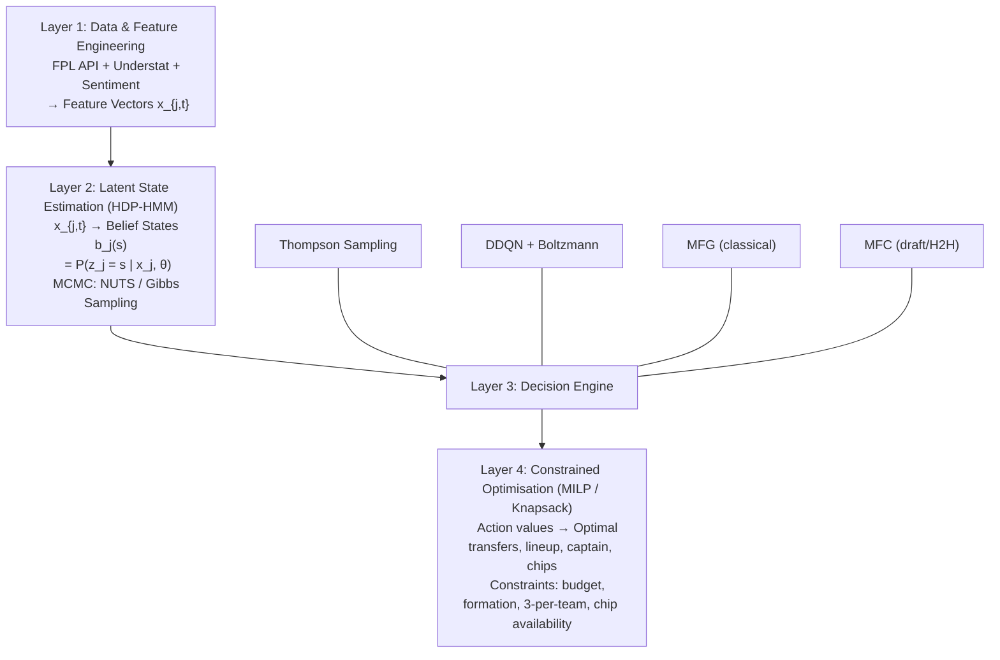

# Chapter 1: Introduction and Problem Formulation

## 1.1 The Fantasy Premier League as a Sequential Stochastic Optimisation Problem

The Fantasy Premier League (FPL) is the world's largest fantasy football game, with over ten million registered participants. Each participant (hereafter referred to as a *manager*) constructs a squad of 15 players drawn from the English Premier League (EPL), subject to budget and compositional constraints. Over the course of a 38-gameweek season, managers make weekly decisions — transfers, captaincy selections, chip deployments — with the objective of maximising their cumulative point total. The stochastic nature of real-world football performance, combined with the sequential and interdependent nature of these decisions, renders FPL a rich domain for applied sequential optimisation under uncertainty.

Formally, let $\mathcal{T} = \{1, 2, \ldots, 38\}$ denote the set of gameweeks. For each gameweek $t \in \mathcal{T}$, a manager chooses an action $a_t$ from a combinatorial action space $\mathcal{A}_t$. The action $a_t$ comprises:

- A set of **transfers** $\tau_t = \{(p^{\text{out}}_1, p^{\text{in}}_1), \ldots, (p^{\text{out}}_k, p^{\text{in}}_k)\}$, where each transfer pair denotes a player leaving and entering the squad, with $k \geq 0$ transfers incurring a point cost of $4 \cdot \max(0, k - f_t)$ where $f_t \in \{1, 2\}$ is the number of free transfers available.
- A **starting lineup** $\ell_t \subset S_t$ of 11 players from the squad $S_t$ of 15, subject to formation validity constraints (minimum 1 goalkeeper, minimum 3 defenders, minimum 1 forward).
- A **captain** $c_t \in \ell_t$ whose points are doubled, and a **vice-captain** $v_t \in \ell_t \setminus \{c_t\}$ who serves as backup captain.
- A **bench ordering** $b_t = (b^1_t, b^2_t, b^3_t, b^4_t)$ specifying substitution priority.
- A **chip decision** $\chi_t \in \{\text{None}, \text{Wildcard}, \text{Free Hit}, \text{Bench Boost}, \text{Triple Captain}\}$, subject to availability constraints (each chip may be used at most once per season, with some chips permitted twice).

The reward at gameweek $t$ is the realised FPL point total minus transfer penalties:

$$R_t = \sum_{p \in \ell_t \setminus \{c_t\}} \phi_p(t) + 2 \cdot \phi_{c_t}(t) + \mathbb{I}(\chi_t = \text{Bench Boost}) \sum_{p \in b_t} \phi_p(t) - 4 \cdot \max(0, k - f_t),$$

where $\phi_p(t)$ denotes the random variable representing player $p$'s FPL point outcome at gameweek $t$, and $\mathbb{I}(\cdot)$ is the indicator function.

The manager's objective is to find a policy $\pi = \{\pi_t\}_{t=1}^{38}$ that maps the information state at each gameweek to an action, maximising the expected cumulative discounted reward:

$$\max_{\pi} \; \mathbb{E}_{\pi}\left[ \sum_{t=1}^{38} \gamma^{t-1} R_t \right],$$

where $\gamma \in (0, 1]$ is a discount factor. In FPL, $\gamma$ is typically set close to 1 (e.g., $\gamma = 0.99$) since future points are nearly as valuable as immediate points, though strategic considerations — such as saving a Wildcard for a double-gameweek — introduce meaningful temporal trade-offs that necessitate genuine intertemporal optimisation.

This formulation is an **intertemporal stochastic control problem** with partial observability, combinatorial actions, and hard constraints. The partial observability arises because the key driver of player performance — their underlying *form* — is a latent, unobservable state. Observed data (goals, assists, bonus points) are noisy emissions from this hidden process.

## 1.2 FPL Rules as Mathematical Constraints

Before developing the theoretical machinery, it is essential to formalise the constraints that govern every decision in FPL. These constraints define the feasible action space and distinguish the FPL problem from unconstrained portfolio optimisation.

### 1.2.1 Budget Constraint

The total squad value must not exceed £100.0 million:

$$\sum_{p \in S_t} \text{price}_p(t) \leq 100.0.$$

Player prices evolve dynamically:

$$\text{price}_p(t+1) = \text{price}_p(t) + \Delta \text{price}_p(t),$$

where $\Delta \text{price}_p(t)$ is determined by the FPL's price change algorithm, which responds to net transfer activity across the population of managers.

### 1.2.2 Squad Composition Constraints

The squad must contain exactly 15 players:

$$|S_t| = 15, \quad |S_t \cap \text{GK}| = 2, \quad |S_t \cap \text{DEF}| = 5, \quad |S_t \cap \text{MID}| = 5, \quad |S_t \cap \text{FWD}| = 3.$$

### 1.2.3 Per-Team Constraint

At most 3 players from any single Premier League club:

$$\forall \, c \in \text{Clubs}: \quad |S_t \cap \text{Players}(c)| \leq 3.$$

### 1.2.4 Formation Validity

The starting lineup must satisfy:

$$|\ell_t \cap \text{GK}| = 1, \quad |\ell_t \cap \text{DEF}| \geq 3, \quad |\ell_t \cap \text{FWD}| \geq 1, \quad |\ell_t| = 11.$$

### 1.2.5 Transfer Constraints

One free transfer per gameweek (accumulating to a maximum of 2):

$$f_{t+1} = \min(2, f_t + 1 - |\tau_t|), \quad \text{cost}_t = 4 \cdot \max(0, |\tau_t| - f_t).$$

### 1.2.6 Chip Constraints

Each chip can be used at most once (some twice):

$$\sum_{t=1}^{38} \mathbb{I}(\chi_t = \text{Wildcard}) \leq 1, \quad \sum_{t=1}^{38} \mathbb{I}(\chi_t = \text{Free Hit}) \leq 1,$$
$$\sum_{t=1}^{38} \mathbb{I}(\chi_t = \text{Bench Boost}) \leq 1, \quad \sum_{t=1}^{38} \mathbb{I}(\chi_t = \text{Triple Captain}) \leq 1.$$

These constraints collectively define a constrained combinatorial optimisation problem that must be solved at every gameweek. The full mathematical treatment of these constraints within the Mixed-Integer Linear Programming (MILP) framework is given in Chapter 8.

## 1.3 FPL Competition Formats

The nature of the optimisation problem depends on the competition format. Four distinct formats exist, each inducing different objective structures.

### 1.3.1 Classical Leagues

Managers are ranked by their cumulative point total over the 38 gameweeks. The global classical leaderboard encompasses all ~10 million participants. This is a **zero-sum ranking game**: a manager's utility depends not only on their absolute point total but on their rank relative to the population. The presence of price dynamics — driven by aggregate transfer activity — introduces a mean-field interaction: individual decisions influence, and are influenced by, collective behaviour. The full Mean-Field Game (MFG) formulation is developed in Chapter 10, Section 10.10.

### 1.3.2 Head-to-Head (H2H) Leagues

Managers are paired against a single opponent each gameweek. The objective is **gameweek-level victory** rather than cumulative point maximisation. This induces a different risk profile: beating an opponent by 1 point is equivalent to beating them by 50 points. The Mean-Field Control (MFC) formulation for H2H leagues is given in Chapter 10, Section 10.11.

### 1.3.3 Draft Leagues

Each player in the EPL can be owned by **at most one manager** in the league. The key distinction is **resource scarcity**: the action space for acquiring players is constrained by what other managers have already selected.

### 1.3.4 Mini-Leagues

Mini-leagues are private competitions (classical or H2H format) among a subset of managers. The smaller population size ($N \ll 10^7$) changes the statistical properties of the rank distribution and the strategic value of differential picks.

## 1.4 The Latent Form Hypothesis

The central modelling hypothesis of this dissertation is that a player's observable FPL performance is driven by a **latent form state** that evolves over the season. This hypothesis addresses a fundamental challenge: a player who scores a hat-trick in one gameweek and blanks in the next has not necessarily changed in ability — rather, their underlying *form* may have transitioned between distinct latent states.

The model posits the existence of a finite (but unknown) set of form profiles — for example, "Elite," "Good," "Average," "Cold," and "Fatigued" — each characterised by a distinct distribution over performance metrics (expected goals, expected assists, ICT index, minutes played). A player's observed performance in any given gameweek is a noisy emission from their current latent form state.

The number of form profiles is not known in advance and must be inferred from the data. This motivates the use of **Bayesian nonparametric methods**, specifically the Hierarchical Dirichlet Process (HDP), which places a prior over the number of clusters and allows the data to determine the appropriate complexity. The HDP is developed from first principles in Chapter 4, and its application to the Gaussian Mixture Model (HDP-GMM) is presented in Chapter 5.

The HDP is extended with a Hidden Markov Model (HMM) layer to capture **form persistence**: a player in "Elite Form" is more likely to remain there in the next gameweek than to abruptly drop to "Cold Form." This temporal structure is developed in Chapter 6.

## 1.5 A Unified Framework Overview

The preceding components — latent form modelling, sequential decision-making, and population-level dynamics — are integrated into a unified, modular framework. The system is structured as a pipeline with four layers, as shown in Figure 1.1.

**Figure 1.1:** Four-layer system architecture. Data flows from feature engineering through latent state estimation, decision engine selection, and constrained optimisation to produce actionable FPL decisions.

**Layer 1: Data & Feature Engineering.** Raw data from the FPL API, Understat, and news sentiment sources is transformed into a unified feature vector for each player-gameweek observation. The feature engineering pipeline is detailed in Chapter 3.

**Layer 2: Latent State Estimation (HDP-HMM).** The Hierarchical Dirichlet Process Hidden Markov Model with a Gaussian-Wishart base estimate maps high-dimensional feature vectors into belief states — probability distributions over latent form profiles. The full mathematical construction of the belief state is given in Chapter 5, Section 5.7.

**Layer 3: Decision Engine.** Four decision engines operate in parallel, each suited to different aspects of the problem:

- **Thompson Sampling** (Chapter 9): A Bayesian approach that maintains a posterior distribution over each player's expected points, samples one "simulated world" per gameweek, and solves the resulting deterministic optimisation problem.
- **DDQN with Boltzmann Policy** (Chapter 10): A deep reinforcement learning approach that learns long-term Q-values for transfer strategies, with smooth exploration controlled by a temperature parameter.
- **MFG Solver** (Chapter 10, Section 10.10): Computes the mean-field equilibrium for classical leagues, capturing the strategic interdependence of population-level transfer behaviour.
- **MFC Solver** (Chapter 10, Section 10.11): Optimises individual decisions in draft and H2H settings under population-level resource constraints.

**Layer 4: Constrained Optimisation (MILP).** The outputs of the decision engine are fed into a Mixed-Integer Linear Program that enforces the FPL constraints (budget, formation, per-team limits, chip availability) and produces the optimal squad, lineup, captaincy, and chip decisions. The full MILP formulation is given in Chapter 8.

## 1.6 Scope and Contributions of This Dissertation

This dissertation makes the following contributions to the theory and practice of sequential optimisation in fantasy sports:

1. **A novel HDP-HMM framework for latent player form modelling**: A non-parametric Bayesian approach to discovering and tracking player form states is developed, with a Gaussian-Wishart base measure that captures the full covariance structure of multi-dimensional performance metrics.

2. **Mean-Field Game analysis of classical FPL leagues**: The classical league is formulated as an MFG, deriving the coupled HJB-FP system that characterises Nash equilibrium behaviour, and analysing the implications for differential strategy and price arbitrage.

3. **Mean-Field Control for draft and H2H leagues**: The draft and H2H problems are formulated as MFC problems, deriving optimal policies that account for resource scarcity and opponent strength distributions.

4. **A unified decision framework integrating Thompson Sampling, DDQN, and MILP**: Bayesian posterior sampling and deep reinforcement learning are combined with exact combinatorial optimisation to produce actionable FPL decisions.

5. **An end-to-end MLOps pipeline**: A production-grade pipeline for automated data ingestion, model updating, inference, and monitoring is designed and implemented, enabling real-time deployment.

The remainder of this dissertation is organised as follows. Chapter 2 provides a literature review positioning this work within the current landscape of sports analytics and machine learning. Chapter 3 details the data acquisition, feature engineering, and exploratory data analysis pipeline. Chapter 4 develops the theoretical foundations of Bayesian nonparametrics, including the CRP, DP, and HDP. Chapter 5 presents the HDP-GMM with Gaussian-Wishart base measure. Chapter 6 extends this to the HDP-HMM with temporal dynamics. Chapter 7 addresses posterior inference via MCMC and NUTS. Chapter 8 addresses constrained optimisation via knapsack and MILP methods. Chapter 9 develops Thompson Sampling for FPL decision-making. Chapter 10 presents the DDQN approach and Bellman equation formulation, integrating the MFG and MFC frameworks. Chapter 11 describes the MLOps pipeline for deployment and monitoring. Chapter 12 presents the experimental results and evaluation, while Chapter 13 provides the conclusion and future work.
