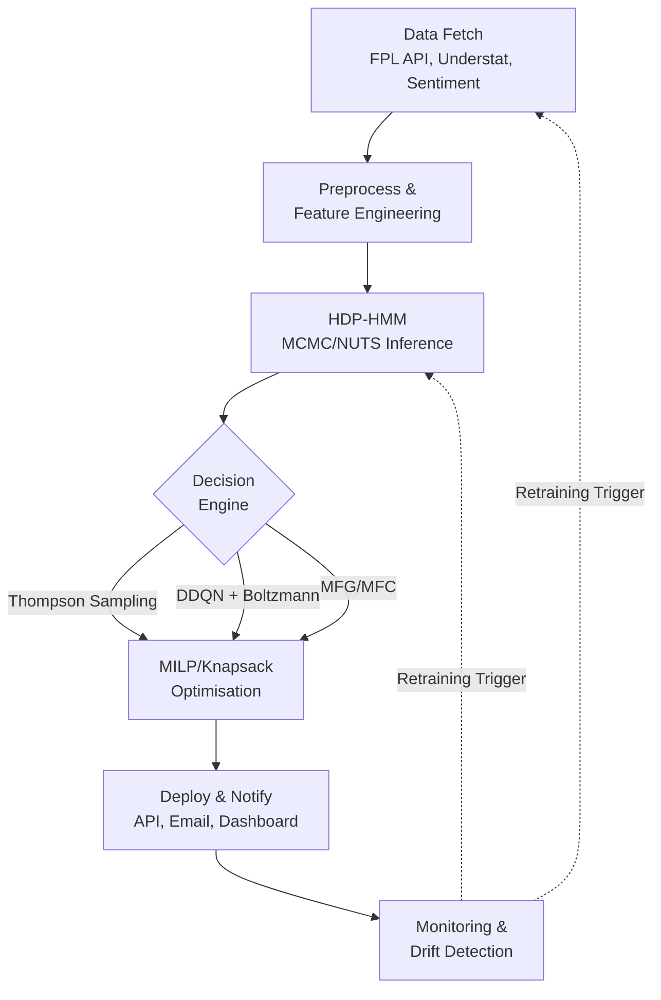

# Chapter 11: MLOps Pipeline, Deployment, and Monitoring

## 11.1 Introduction

The models and algorithms developed in Chapters 1–10 form a sophisticated decision-making system for Fantasy Premier League management. However, the practical value of this system depends critically on its ability to operate **reliably, automatically, and continuously** over the 38-gameweek season. This requires a production-grade Machine Learning Operations (MLOps) pipeline that handles:

1. **Automated data ingestion**: Fetching, cleaning, and merging data from the FPL API, Understat, sentiment sources, and injury databases within the narrow post-gameweek window.
2. **Model updating**: Running the HDP-HMM MCMC chain and updating the DDQN weights with new data, without manual intervention.
3. **Inference and decision generation**: Executing the Thompson Sampling or DDQN decision pipeline to produce transfer, lineup, captaincy, and chip recommendations.
4. **Monitoring and alerting**: Tracking model performance, detecting concept drift, and triggering retraining when necessary.
5. **Reproducibility**: Versioning data, code, and models to ensure that every recommendation can be traced back to the exact inputs that produced it.

This chapter provides a platform-agnostic blueprint of the MLOps pipeline, covering the tools, architecture, and workflows that enable the system to operate autonomously.

## 11.2 System Architecture Overview

The MLOps pipeline is organised as a Directed Acyclic Graph (DAG) of tasks, orchestrated by a workflow scheduler such as Apache Airflow, Prefect, or a cron-based system. The DAG is triggered on a schedule (after each gameweek concludes) and executes the stages shown in Figure 11.1.



**Figure 11.1:** MLOps pipeline DAG. Each stage is a modular, containerised service, ensuring isolation, reproducibility, and scalability across deployment environments.

## 11.3 Data Ingestion and Versioning

### 11.3.1 Orchestrated Data Pipeline

The data ingestion pipeline is defined as a workflow DAG with the following stages:

```
Algorithm: Data Ingestion Workflow
Trigger: Weekly schedule (after gameweek concludes)

Stage 1: Fetch FPL Bootstrap Data
    response ← GET(fantasy.premierleague.com/api/bootstrap-static/)
    players, teams ← parse(response)

Stage 2: Fetch Fixture Data
    fixtures ← GET(fantasy.premierleague.com/api/fixtures/)

Stage 3: Fetch Understat Advanced Metrics
    understat_data ← async_scrape(understat.com/league/EPL/season)
    // Parse embedded JSON from <script> tags via regex pattern matching

Stage 4: Fetch Sentiment Data
    articles ← query_news_apis(player_names, window=7_days)
    sentiments ← DeBERTa_v3_sentiment_analysis(articles)

Stage 5: Merge and Engineer Features
    merged ← join(players, fixtures, understat_data, sentiments, on=player_id)
    features ← per_90_normalisation(merged)
    features ← rolling_averages(features, windows=[3, 5, 10])
    features ← standardise(features, scaler=fitted_on_training_set)

Stage 6: Version Data
    dvc_add(features)
    dvc_push(remote_storage)
```

### 11.3.2 Data Versioning

**DVC (Data Version Control)** tracks the data files alongside the Git-tracked code. Each data artefact is assigned a content-addressable hash, and the `.dvc` metadata files are committed to Git. This ensures that every experiment is linked to a specific data version, enabling full reproducibility.

### 11.3.3 Schema Validation

To catch data quality issues early, the schema of incoming data is validated against a predefined specification:

```
Algorithm: Schema Validation
Input: Raw data table df
Output: Pass/Fail with error details

For each column in schema:
    If column required and column not in df:
        Raise ValidationError("Missing required column")
    If column type mismatch:
        Raise ValidationError("Type mismatch")
    If column constraints violated (e.g., negative minutes):
        Raise ValidationError("Constraint violation")

If all checks pass:
    Return Pass
```
## 11.4 Model Training and Retraining

### 11.4.1 HDP-HMM MCMC Pipeline

After ingestion, the pipeline loads the versioned feature matrix and its saved scaler, then standardises the new observations. It initialises from the previous posterior mean with reduced warmup when available, or from the prior with full warmup otherwise. NumPyro runs NUTS with the configuration in Chapter 7, Section 7.4; the pipeline computes the $\hat{R}$ and ESS diagnostics described in Section 7.7 and flags a warning when the maximum $\hat{R}$ exceeds 1.01. Posterior samples, diagnostics, and metadata are stored in the model registry with the data-version tag.

### 11.4.2 Bayesian Updating

The sequential Bayesian target uses the preceding gameweek's posterior as the current prior:

$$P(\theta \mid \mathcal{D}_{t}) \propto P(x_t \mid \theta) \cdot P(\theta \mid \mathcal{D}_{t-1}).$$

The pipeline operationalises this target by initialising at the previous posterior mean and reducing warmup steps (Section 11.4.1); this is a warm-start approximation, not an exact posterior update. Its runtime benefit remains to be measured.

### 11.4.3 DDQN Retraining

The DDQN is retrained on a schedule (every 4 gameweeks) or when performance degrades:

```
Algorithm: DDQN Retraining
Trigger: Every 4 gameweeks or performance degradation

Stage 1: Load Replay Buffer
    D ← load_saved_buffer(storage)

Stage 2: Add New Experiences
    For each recent gameweek t:
        D.push(s_t, a_t, r_t, s_{t+1})

Stage 3: Train
    For epoch = 1 to num_epochs:
        batch ← D.sample(batch_size)
        For each (s, a, r, s', done) in batch:
            a_best ← argmax_{a'} Q_online(s', a'; θ)
            y ← r + γ · Q_target(s', a_best; θ') · (1 - done)
            loss ← (y - Q_online(s, a; θ))²
            θ ← θ - α · ∇_θ loss
        If step mod C == 0:
            θ' ← θ

Stage 4: Evaluate
    val_reward ← evaluate_on_held_out_data(previous_season)
    If val_reward > best_val_reward:
        Register new model weights in registry
```

### 11.4.4 Experiment Tracking

A model registry tracks all experiments, logging:
- **Parameters**: Model hyperparameters (γ, α, K, learning rate, batch size).
- **Metrics**: ELBO, log-likelihood, r_hat, ESS, validation reward, regret.
- **Artefacts**: Posterior samples, model weights, convergence plots.
- **Data version**: The commit hash and data revision associated with the training data.

## 11.5 Inference and Decision Pipeline

### 11.5.1 Prediction Service

The prediction service exposes an API endpoint for generating recommendations:

```
Algorithm: Recommendation API
Endpoint: POST /recommend
Input: {gameweek: int, team_id: str, league_type: str}
Output: {transfers, lineup, captain, chip}

Stage 1: Load Latest Models
    hdp_hmm_posterior ← load_from_registry("hdp-hmm/Production")
    ddqn_weights ← load_from_registry("ddqn/Production")  // if using DDQN

Stage 2: Compute Belief States
    belief_states ← infer_from(latest_data, hdp_hmm_posterior)  // outputs: Chapter 7, Section 7.9.1

Stage 3: Run Decision Engine
    If league_type == "classical":
        recommendations ← run_mfg_engine(belief_states)  // formulation: Chapter 10, Section 10.10
    Else if league_type == "draft":
        recommendations ← run_mfc_engine(belief_states)  // formulation: Chapter 10, Section 10.11
    Else:
        recommendations ← run_thompson_sampling(belief_states)  // method: Chapter 9

Stage 4: Solve MILP
    transfers, lineup, captain, chip ← solve_constrained_opt(recommendations)

Stage 5: Return Response
    Return {transfers, lineup, captain, chip, gameweek}
```

### 11.5.2 Containerised Deployment

The prediction service is packaged as a container image with the following structure:

```
Docker Image Structure:
    Base: Python 3.11 slim
    Dependencies: JAX/NumPyro, PuLP/ortools, FastAPI
    Model artefacts: Posterior samples, DDQN weights, scalers
    Application: Prediction service code

Runtime:
    CMD: uvicorn main:app --host 0.0.0.0 --port 8000
    Health check: GET /health → 200 OK
```

The proposed container design targets environments that support container runtimes (e.g., a local server, a cloud VM, or a managed container platform). For redundancy, two or more replicas could run behind a simple load balancer.

## 11.6 Model Monitoring and Drift Detection

### 11.6.1 Performance Tracking

After each gameweek, the agent's performance is logged:

```
Algorithm: Performance Logging
Input: gameweek, actual_points, predicted_points, rank

Log:
    gw_{gameweek}_actual_points ← actual_points
    gw_{gameweek}_predicted_points ← predicted_points
    gw_{gameweek}_prediction_error ← |actual - predicted|
    gw_{gameweek}_rank ← rank
```

Key metrics monitored:
- **Cumulative points**: Compared to the average FPL manager and the top 10k threshold.
- **Prediction error**: MAE and RMSE between predicted and actual player points.
- **Transfer efficiency**: Points gained from transfers vs. points lost from transfer costs.
- **Captaincy success rate**: Percentage of gameweeks where the chosen captain was the highest-scoring starter.

### 11.6.2 KL-Divergence Drift Detection

To detect concept drift, the KL divergence between belief state distributions from one gameweek to the next is monitored:

$$\text{KL}_j(t) = \text{KL}(b_j(t) \parallel b_j(t-1)) = \sum_{k=1}^K b_j^{(k)}(t) \log \frac{b_j^{(k)}(t)}{b_j^{(k)}(t-1)}.$$

The population-level drift is the average across all players:

$$\text{KL}_{\text{pop}}(t) = \frac{1}{J} \sum_{j=1}^J \text{KL}_j(t).$$

A significant spike in $\text{KL}_{\text{pop}}(t)$ (e.g., exceeding the 95th percentile of historical values) triggers an alert and may initiate a full model retraining.

### 11.6.3 Posterior Distribution Monitoring

The posterior distributions themselves are also monitored:

- **Number of active clusters**: If the number of clusters with $>1\%$ posterior mass changes significantly, the model may be overfitting or underfitting.
- **Posterior variance**: An increase indicates growing uncertainty, which may signal a change in the underlying process (e.g., a new tactical meta in the Premier League).
- **Transition matrix stability**: The Frobenius norm $\|\boldsymbol{\pi}^{(t)} - \boldsymbol{\pi}^{(t-1)}\|_F$ measures the stability of form dynamics.

### 11.6.4 Alerting

Alerts are sent via email, messaging platform, or dashboard notification when:
- Prediction error exceeds a threshold (e.g., MAE > 3 points per player).
- KL divergence spikes (indicating concept drift).
- MCMC convergence fails ($\hat{R} > 1.01$).
- The agent's rank drops below a target threshold (e.g., top 1% of the global classical league).

## 11.7 Automated Retraining Triggers

The system supports two retraining modes:

### 11.7.1 Scheduled Retraining

The model is retrained on a fixed schedule (every 4 gameweeks) regardless of performance. This ensures the model adapts to gradual changes in the data distribution.

### 11.7.2 Triggered Retraining

The model is retrained immediately when a trigger condition is met:
- **KL divergence spike**: $\text{KL}_{\text{pop}}(t) > \text{threshold}$.
- **Performance degradation**: The agent's cumulative points over the last 4 gameweeks are below the 25th percentile of historical performance.
- **Data schema change**: The FPL API changes its data format.
- **Manual trigger**: A human operator initiates a retrain via the model registry UI.

### 11.7.3 Full vs. Incremental Retraining

- **Incremental update**: The MCMC chain is continued from the previous posterior with the new data. The planning estimate is minutes; benchmark this runtime for minor distribution shifts.
- **Full retrain**: The MCMC chain is reinitialised from scratch using all available data. The planning estimate is hours; benchmark this runtime for major distribution shifts (e.g., new season, rule changes).

The proposed orchestrator would choose the appropriate retraining mode based on the trigger.

## 11.8 Computational Acceleration

### 11.8.1 GPU Acceleration

The proposed NumPyro MCMC benchmark compares GPU acceleration for the NUTS sampler against CPU-only execution. The draft target is a **5–10x speedup**, to be verified and reported with the hardware and runtime in Chapter 12, Section 12.9; no measured result is presented here.

### 11.8.2 TPU Support

For larger-scale experiments, the proposed pipeline can use TPU backends via JAX. A benchmark would compare vectorised HDP-HMM FFBS on a TPU against single-GPU execution; the draft's **20x speedup** is a hypothesis to test, not a measured result.

## 11.9 Reproducibility and Experimentation

### 11.9.1 Seed Control

All random number generators are seeded for reproducibility:

```
Set SEED = 42
random.seed(SEED)
numpy.random.seed(SEED)
jax.random.PRNGKey(SEED)
```

### 11.9.2 Experiment Registry

Every experiment is registered with a unique run ID, linking the code version, data version, model parameters, and results. This enables:
- **Reproducing any past recommendation** by checking out the specific code and data versions.
- **Comparing model versions** via a visual dashboard of metrics across runs.
- **Rolling back** to a previous model version if the current one underperforms.

### 11.9.3 A/B Testing

When a new model version is developed, it is evaluated via shadow mode:
1. **Shadow mode**: The new model generates recommendations in parallel with the current model, but only the current model's recommendations are executed.
2. **Comparison**: After 4 gameweeks, compare the cumulative points, prediction errors, and rank trajectories.
3. **Promotion**: If the new model outperforms the current model, promote it to "Production" via the model registry.

## 11.10 Production Implementation Notes

### 11.10.1 KL-Divergence Implementation Details

The KL-divergence computation (§11.6.2) requires careful handling of near-zero probabilities to avoid numerical instability. The implementation uses **epsilon smoothing**:

$$\tilde{p}_k = \text{clip}(p_k, \epsilon, 1.0), \quad \tilde{q}_k = \text{clip}(q_k, \epsilon, 1.0), \quad \text{followed by renormalisation},$$

with $\epsilon = 10^{-10}$. Without this smoothing, belief states with zero probability in some clusters (which occurs when the MCMC chain assigns no posterior mass to certain clusters) would produce $-\infty$ in the log-ratio computation.

The drift threshold is computed as the **95th percentile** of historical drift values, requiring at least 5 historical observations for a meaningful threshold. The combined retraining decision (`should_retrain`) integrates three independent signals — KL drift, performance degradation (recent points below the 25th percentile of historical), and forced periodic schedule — triggering retraining if any signal fires.

### 11.10.2 ASUGS Gradient Simplification

The ASUGS update uses the simplified gradient approximation defined in Chapter 7, Section 7.10.2, in place of the digamma-based gradient in Section 7.8. Its step-size schedule is specified there as well (for example, $\eta_n = 1/n$); the deployment procedure applies that update when the configured drift trigger fires (§11.7.2).

## 11.11 Summary

This chapter sets out a proposed MLOps pipeline for the FPL sequential optimisation system. A workflow orchestrator would manage data ingestion and model updating after each gameweek. Data versioning and an experiment registry are specified to support reproducibility and artefact tracking. The proposed prediction service can be containerised and expose an API for recommendations. KL-divergence monitoring can trigger retraining when configured conditions are met. GPU/TPU acceleration and incremental versus full retraining require runtime benchmarks; Chapter 12, Section 12.9 is planned to report those measurements. The deployment design is platform-agnostic and targets environments that support container runtimes.
